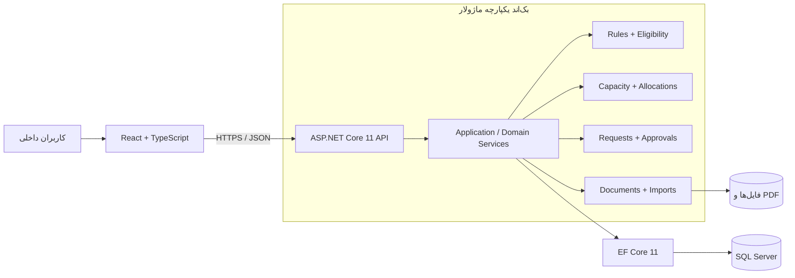
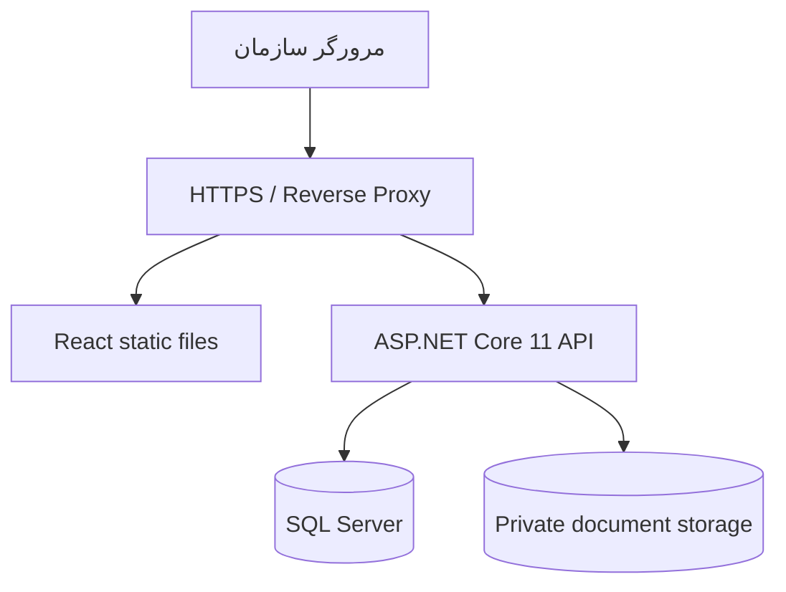

# سند بازنگری‌شده معماری و پشته فناوری

**پروژه:** سامانه مدیریت ارجاع کار مجریان ذی‌صلاح ساختمان، دفتر نمایندگی دزفول  
**نسخه سند:** `0.4-draft`  
**وضعیت:** پیش‌نویس بررسی مالک محصول؛ سند اصلی و مخزن پروژه تغییری نکرده‌اند.  
**مبنای فنی قطعی اعلام‌شده از سوی مالک محصول:** `ASP.NET Core 11` روی `.NET 11` (هدف `net11.0`)؛ `React + TypeScript`؛ `Microsoft SQL Server`؛ معماری `Modular Monolith`.  
**اسناد مبنا:** `Technology Stack Specification.md`، `Dezful_Executor_System_Decision_Register_v01.md`، `Business_Rules_Specification_Dezful_MVP_v04_Draft.md`، `Data_Dictionary_Entity_Schema_Dezful_MVP_v04_Draft.md`، `User_Flows_Wireframe_Logic_Dezful_MVP_v04_Draft.md`.

> این سند تصمیمات تحلیل کسب‌وکار را **به معماری قابل ساخت** تبدیل می‌کند. پیشنهادهای فنی این سند تا زمان تأیید مالک محصول، تصمیم قطعی محسوب نمی‌شوند. اعداد ظرفیت، اختیار استثنا و ضوابط دزفول باید بر اساس مستند رسمی مستقل تأیید شوند.

## ۱. اهداف، مرزها و اصول

### ۱.۱. اهداف نسخه اول

1. سامانه داخلی یک دفتر در دزفول با تعداد کاربران اولیه محدود: کارشناس ثبت، کارشناس بررسی، رئیس دفتر و مدیر سامانه.
2. پوشش کامل جریان درخواست، بررسی کارشناسی، تصمیم رسمی، تخصیص مجری، تغییرات پروژه و ظرفیت، گزارش پیشرفت، آزادسازی و خاتمه.
3. کنترل دقیق ظرفیت **متراژ و تعداد کار هم‌زمان** با ثبت تراکنشی و حسابرسی مستقل.
4. ثبت نسخه قواعد، نسخه تنظیمات گردش کار، دلیل تصمیم و `Decision Snapshot`.
5. راه‌اندازی قابل اتکا در محیط داخلی سازمان یا استقرار اینترنتیِ حفاظت‌شده، بدون وابستگی اجباری به ابر یا سرویس‌های خارجی.
6. امکان یادگیری و کنترل توسعه توسط مالک محصول؛ ساختار پروژه روشن، آزمون‌پذیر و فاقد انتزاع‌های زائد باشد.

### ۱.۲. عمداً خارج از دامنه نسخه اول

- چندمستاجری، موتور پویا و گرافیکی گردش کار، کارتابل مشترک/برداشت پرونده و توزیع پیشرفته چندکارشناس.
- پورتال عمومی مالک و مجری، حساب کاربری بازرس، پیامک، ایمیل، عملیات برخط شهرداری و سایر یکپارچه‌سازی‌های ملی.
- سرویس‌های خرد (`Microservices`)، صف پیام توزیع‌شده، `CQRS` سراسری، `Event Sourcing`، موتور جست‌وجوی مستقل، ذخیره‌ساز شیء اجباری و زیرساخت `Kubernetes`.
- توسعه زودهنگام ماژول حسابداری، قرارداد مالی پیشرفته، هوش مصنوعی یا ابزار طراحی گزارش پویا.

### ۱.۳. اصل معماری

**یک برنامه بک‌اند قابل استقرار، یک پایگاه داده، یک فرانت‌اند و مرزهای واضح در کد.** واژه «ماژول» به معنی مرز منطقی مسئولیت است، نه الزام به سرویس، پایگاه داده یا استقرار مستقل.



## ۲. جدول پشته انتخابی

| لایه | انتخاب نسخه اول | جایگاه تصمیم |
|---|---|---|
| Runtime و SDK | `.NET 11`، هدف `net11.0` | **انتخاب قطعی مالک محصول**؛ نسخه وصله‌ای تثبیت شود |
| وب و API | `ASP.NET Core 11 Web API`، `C#` | قطعی در سطح خانواده فناوری |
| دسترسی داده | `Entity Framework Core 11` + ارائه‌دهنده `Microsoft.EntityFrameworkCore.SqlServer` | پیشنهاد هم‌نسخه و سازگار |
| پایگاه داده | `Microsoft SQL Server` | انتخاب قبلی ثابت |
| فرانت‌اند | `React + TypeScript` با `Vite` | انتخاب قبلی ثابت |
| فرم و اعتبارسنجی کلاینت | `React Hook Form` + `Zod` | پیشنهاد ادامه سند قبلی |
| رابط کاربری | `Tailwind CSS` و رعایت `RTL` و `fa-IR` | پیشنهاد ادامه سند قبلی |
| API Contract | `OpenAPI` از امکانات رسمی `ASP.NET Core`؛ UI مستندات صرفاً در محیط مناسب | پیشنهاد |
| احراز هویت | `ASP.NET Core Identity` با گذرواژه محلی و کوکی امن برای استقرار هم‌مبدأ | **پیشنهاد**؛ نهایی با تصمیم استقرار |
| مجوزدهی | `RBAC` و سیاست‌های مخصوص انتصاب سازمانی | الزامی، فناوری اجرا پیشنهاد |
| آزمون | `xUnit`، آزمون یکپارچه با SQL Server واقعی و آزمون‌های رابط کاربری منتخب | پیشنهاد اجرایی |
| ثبت رویداد و تشخیص | `ILogger`، شناسه هم‌بستگی درخواست، فایل/خروجی لاگ مناسب محیط | پیشنهاد |
| اسناد | فایل سرور با متاداده در SQL Server و رابط ذخیره‌سازی قابل تعویض | پیشنهاد سبک |
| استقرار | Windows Server/IIS یا Linux/reverse proxy، یک استقرار بک‌اند و فایل‌های استاتیک React | گزینه‌های مجاز، انتخاب نهایی باز |

**توجه پشتیبانی:** نسخه `.NET 11` در ۱۰ نوامبر ۲۰۲۶ منتشر شده و از نوع `STS` است؛ پایان پشتیبانی اعلام‌شده ۱۴ نوامبر ۲۰۲۸ است. بنابراین مسیر وصله‌های امنیتی و برنامه ارتقای بعدی باید پیش از استقرار مشخص باشد. این واقعیت تغییری در انتخاب شما نمی‌دهد. مرجع: https://dotnet.microsoft.com/en-us/platform/support/policy

**اصل سازگاری:** تمام پروژه‌های C# باید `TargetFramework=net11.0` داشته باشند؛ بسته‌های اصلی `Microsoft.EntityFrameworkCore.*` از شاخه `11.x` و در **همان نسخه وصله** نصب شوند. عدد دقیق آخرین وصله در زمان ایجاد پروژه بررسی و در قفل وابستگی‌ها ثبت شود؛ نسخه‌های `preview/rc` در انتشار عملیاتی پذیرفته نیستند.

## ۳. سازمان‌دهی کد و ماژول‌ها

### ۳.۱. طرح پیشنهادی Solution

```text
repo-root/
├── README.md
├── docs/
│   ├── decisions/
│   ├── architecture/
│   ├── business-rules/
│   └── workflows/
├── src/
│   ├── ExecutorReferrals.Api/
│   ├── ExecutorReferrals.Application/
│   ├── ExecutorReferrals.Domain/
│   └── ExecutorReferrals.Infrastructure/
├── tests/
│   ├── ExecutorReferrals.UnitTests/
│   └── ExecutorReferrals.IntegrationTests/
├── web/
│   └── (React + TypeScript + Vite)
└── scripts/
    └── (مهاجرت داده، کنترل و پشتیبان‌گیری)
```

این چهار پروژه کتابخانه‌ای/اجرایی **چهار سرویس** نیستند. اگر اندازه واقعی کد در ابتدای کار کوچک باشد، می‌توان با ساختار پوشه‌ای همین مرزها را حفظ کرد و در صورت نیاز پروژه‌ها را جدا نمود. انتخاب نهایی باید قبل از ایجاد ساختار اولیه توسط مالک محصول تأیید شود.

### ۳.۲. مسئولیت لایه‌ها

| بخش | مسئولیت مجاز | نباید انجام دهد |
|---|---|---|
| `Domain` | موجودیت، مقدارهای دامنه، قواعد محاسباتی مستقل، ناورداهای پایه | وابستگی مستقیم به `HTTP`، `EF Core` یا کد UI |
| `Application` | فرمان‌های کاری، مجوز کاربردی، ترتیب مراحل، کنترل نتیجه قواعد، هماهنگی تراکنش‌ها در سطح موردکاربرد | تصمیم‌گیری بر اساس وضعیت بصری فرم یا فراخوانی مستقیم فایل‌سیستم بدون واسط |
| `Infrastructure` | نگاشت `EF Core`، `SQL Server`، تولید فایل، ذخیره‌سازی، احراز هویت و ورودی اکسل | تعیین مستقل سیاست حقوقی یا دورزدن روند تأیید |
| `Api` | endpoint، اعتبارسنجی شکل درخواست، سیاست دسترسی، تبدیل خطا به HTTP، `OpenAPI` | اجرای محاسبات حساس ظرفیت در controller |
| `web` | فرم، کارتابل، جست‌وجو، نمایش خطا و وضعیت، تجربه فارسی | جایگزینی کنترل دسترسی و اعتبارسنجی سمت سرور |

**از افراط در انتزاع پرهیز شود:** استفاده از `DbContext` و سرویس‌های کاربردی روشن، بر افزودن اجباری `Generic Repository` و `Generic Unit of Work` بر روی EF Core ترجیح دارد. همان‌جا که چند عملیات مرتبط به تراکنش واحد نیاز دارند، یک سرویس تخصصی تعریف شود.

### ۳.۳. مرزهای دامنه (پوشه/ماژول منطقی)

| ماژول | موضوع و موجودیت‌های اصلی | وابستگی کلیدی |
|---|---|---|
| `Executors` | `Executor`، `Executor_License`، `Company_Key_Member`، وضعیت‌های محدودکننده | `Rules`، `Capacity` |
| `Projects` | `Construction_Project`، شناسه شهرداری، مشخصات فنی، پیشرفت رسمی | `Requests`، `Allocations` |
| `Requests` | `Review_Request`، `Expert_Evaluation`، `Formal_Decision`، گردش تأیید | `Rules`، `Allocations` |
| `Rules` | `Regulation_Version`، `Quota_Rule_Matrix`، پارامترها و تاریخ اعتبار | `Executors` و `Projects` برای ورودی ارزیابی |
| `Allocations` | `Project_Allocation`، تاریخچه مسئولیت و تعویض مجری | `Capacity` |
| `Capacity` | `Capacity_Movement`، اصلاحیه‌ها و مانده ظرفیت، آزادسازی | `Rules`، `Allocations` |
| `Progress` | گزارش بازرس/پیشرفت و درخواست آزادسازی | `Projects`، `Capacity` |
| `Documents` | سند، چک‌لیست، قالب و نسخه فرم پذیرش | ارجاع با کلید مالک سند |
| `Imports` | فایل اکسل، ردیف‌های معتبر/خطا، تأیید افتتاحیه | `Executors`، `Projects`، `Capacity` |
| `IdentityAndAdmin` | کاربران، نقش‌ها، انتصاب رئیس، جانشینی، اعلان، ثبت ممیزی | دامنه‌های مختلف |
| `Reporting` | نماهای خواندنی و خروجی‌ها با رعایت مجوزها | فقط خواندن از داده‌های مصوب |

در نسخه اول، این‌ها **۱۱ مرز مسئولیت** هستند، نه الزاماً ۱۱ پروژه C# یا ۱۱ دیتابیس. ارتباط‌ها درون یک فرآیند و با فراخوانی سرویس‌های کاربردی انجام می‌شوند؛ به گذرگاه رویداد خارجی نیاز نیست.

## ۴. طراحی داده و تراکنش‌های حساس

### ۴.۱. منبع حقیقت ظرفیت

- سقف مجاز متراژ و کار با قواعد مؤثر و وضعیت پروانه/شرکت تعیین می‌شود.
- مصرف واقعی ظرفیت بر اساس مانده تخصیص‌ها و گردش ثبت‌شده در `Capacity_Movement` محاسبه می‌شود، نه صرفاً وضعیت `ACTIVE` پروژه.
- `FreeArea = MaxArea - BlockedArea` و `FreeJobs = MaxJobs - BlockedJobs`. مانده آزاد **ممکن است منفی** باشد؛ نمایش مقدار منفی مجاز و به معنای مجوز خودکار تخصیص نیست.
- رکوردهای `Decision_Snapshot_Log` پس از ایجاد تغییرناپذیرند. اصلاح مجاز گردش ظرفیت در مدل اصلاحیه و `Audit_Event` ثبت می‌شود؛ اثر محاسباتی جدید با تاریخچه قبلی قابل ردیابی می‌ماند.
- تمام اعداد متراژ با `decimal` و دقت مشخص ذخیره شوند؛ استفاده از `float` یا `double` در ظرفیت ممنوع است.

### ۴.۲. تأیید تخصیص: یک تراکنش واحد

ترتیب هدف (نه دستور SQL نهایی):

1. بررسی `authenticated_user`، نقش اجرایی، انتصاب رئیس یا جانشینی معتبر و دامنه اختیار.
2. گرفتن کنترل رقابت برای **مجری موردنظر** و **پرونده مربوط** در تراکنش؛ برای مثال قفل ردیف‌های قابل اتکا یا `sp_getapplock` با نام استاندارد و بازه تراکنش.
3. بازخوانی مجدد پروانه، حالت معلق، نسخه معتبر قواعد، گروه فنی پروژه، ظرفیت متراژ/کار آزاد، فرم پذیرش و وضعیت همه درخواست‌های تعارض‌دار.
4. محاسبه مجدد احراز صلاحیت و ظرفیت **بر پایه لحظه تصمیم**؛ اجازه عدول فقط از شروطی که نسخه معتبر «قابل استثنا» تعریف کرده و تصمیم‌گیرنده اختیار قانونی لازم دارد.
5. ثبت تصمیم، `Decision Snapshot`، تخصیص و گردش ظرفیت متراژ/تعداد کار؛ سپس تغییر وضعیت درخواست و ذخیره اعلان داخلی.
6. `Commit` به‌صورت اتمیک؛ در هر خطا کل مجموعه `Rollback` شود. درخواست تکراری یا تصمیم دوم رئیس/جانشین باید بدون تخصیص دوم پاسخ مناسب دریافت کند.

**نکته مهم:** `rowversion` به‌تنهایی کافی نیست؛ هرچند از بازنویسی فرم جلوگیری می‌کند، دو تصمیم روی دو درخواست جدا ممکن است هم‌زمان آخرین سهمیه یک مجری را مصرف کنند. کنترل رقابت باید در سطح **منبع ظرفیت مشترک مجری** انجام شود. الگوی قفل، ترتیب ثابت قفل‌ها و سیاست `Retry` خطاهای گذرا در آزمون یکپارچه SQL Server اثبات شوند.

### ۴.۳. آزادسازی و خاتمه

- آستانه پیشرفت فعلاً ۸۰٪ و قابل تنظیم است؛ **ثبت گزارش** به‌تنهایی هیچ سهمیه‌ای آزاد نمی‌کند.
- با تأیید نهایی درخواست آزادسازی، فقط **مانده اشغال** همان تخصیص، شامل متراژ و یک سهمیه کار در صورت اشغال بودن، آزاد شود؛ آزادسازی دوم بدون اثر مالی/ظرفیتی ثبت شود یا رد شود، نه اینکه مانده منفی اشغال ایجاد کند.
- پروژه می‌تواند همچنان در حال اجرا و دارای مجری مسئول باشد، حتی اگر مانده ظرفیت تخصیص صفر باشد.
- خاتمه تخصیص با پایان پروژه فرق دارد؛ در جانشینی مجری، مجری جدید ظرفیت **کار باقی‌مانده در تحویل** را اشغال می‌کند اما صلاحیت او با مشخصات **کل پروژه** کنترل می‌شود.
- در تغییر متراژ و آزادسازی‌های معوق، قواعد توقف/بازارزیابی توافق‌شده در `Business Rules` و `User Flows` مرجع است.
- قفل/تراکنش و شناسه یکتای رویداد کاری (`idempotency` یا قید یکتایی مناسب) از آزادسازی تکراری جلوگیری کند.

### ۴.۴. کنترل هم‌زمانی فرم‌ها

- موجودیت‌های ویرایش‌پذیر مهم از `SQL Server rowversion` استفاده کنند.
- درخواست تغییر با نسخه قبلی باید `HTTP 409 Conflict` (یا `412 Precondition Failed` با طراحی قرارداد شرطی) برگرداند؛ شکل پاسخ استاندارد و UI آن از ابتدا یکسان باشد.
- کاربر باید پیش از تکرار اصلاحات، داده جدید را دریافت کند. هیچ «آخرین ذخیره برنده است» نداریم.

### ۴.۵. یکپارچگی پایگاه داده

- کلیدهای خارجی، محدودیت‌های معتبر `CHECK`، شاخص‌های یکتا/فیلترشده برای «حداکثر یک درخواست باز از یک نوع» و «حداکثر یک درخواست آزادسازی باز برای هر تخصیص» اعمال شوند؛ شرایط باز/بسته در مدل وضعیت رسمی تعریف گردد.
- شناسه شماره پرونده شهرداری به عنوان کلید کسب‌وکار با بررسی تکراری بودن استفاده شود؛ کلید اصلی داخلی مستقل باقی بماند.
- روی نسخه‌های قواعد و انتصاب جانشین، بازه‌های زمانی متعارض در سرویس و در صورت نیاز با سازوکار دیتابیس کنترل شوند.
- `Migration`‌های EF Core فقط پس از بازبینی مالک محصول اعمال شوند؛ ایجاد و اجرای خودکار تغییر ساختار پایگاه داده در زمان روشن‌شدن برنامه عملیاتی مجاز نباشد.

## ۵. وضعیت‌ها و نسخه قواعد/گردش کار

- گردش کار ثابت است و به «طراح گردش کار پویا» نیازی ندارد. تنظیم نقش مسئول، شروط مصوب و چک‌لیست مدارک در `Workflow_Config_Version` نسخه‌بندی می‌شود.
- هر درخواست به **نسخه تنظیمات گردش کار در زمان ایجاد** متصل می‌شود. تغییرات بعدی مسیر همان درخواست را بی‌اجازه عوض نمی‌کند.
- **قواعد صلاحیت و ظرفیت** مستقل‌اند: نسخه معتبر در **زمان تأیید نهایی** ملاک عمل است و ارزیابی قبلی در صورت تغییر باید تازه‌سازی شود.
- `Project_Status`، `Allocation_Status`، `Blocked_Capacity_Status` و `Request_Status` یک ستون یا `enum` واحد نیستند.
- فقط یک `Review_Request` باز به‌ازای پروژه مجاز است؛ انواع درخواست عملیاتی و آزادسازی، مجموعه گردش کار مستقل دارند و با ماتریس تداخل کنترل می‌شوند.

## ۶. امنیت، نقش و اختیار سازمانی

### ۶.۱. ورود و نشست

- در MVP فقط حساب داخلی با نام کاربری/گذرواژه داریم. `ASP.NET Core Identity` برای مدیریت کاربران، هش امن رمز، غیرفعال‌سازی و بازنشانی پیشنهاد می‌شود.
- برای فرانت‌اند و API با یک مبدأ منتشرشده، **کوکی نشست امن** با `HttpOnly`، `Secure`، سیاست `SameSite` متناسب و کنترل `CSRF` پیشنهاد می‌شود. در توسعه جداگانه `Vite`/API، `proxy` محلی در نظر گرفته شود؛ توکن در `localStorage` نگهداری نشود.
- استفاده از `JWT` برای پورتال‌های بیرونی را در MVP اجباری نکنیم؛ اگر معماری استقرار چندمبدأ لازم شد، تصمیم جداگانه با تهدیدسنجی ثبت شود.
- تمام دسترسی‌ها از سمت سرور بررسی شوند؛ `React` فقط برای تجربه کاربری دکمه‌ها را مخفی می‌کند.
- سیاست رمز عبور مناسب، محدودیت تلاش ورود، نشست منقضی، `HTTPS`، مدیریت اسرار بیرون از مخزن و ثبت رخدادهای امنیتی الزامی‌اند.

### ۶.۲. تفاوت نقش و اختیار اداری

- کاربر می‌تواند چند نقش داشته باشد و مجموعه مجوزهای مجاز را کسب کند.
- **تأیید نهایی رئیس دفتر از طریق نقش `Admin` یا یک permission آزادشدنی به دست نمی‌آید**؛ باید انتصاب معتبر رئیس یا ابلاغ جانشینیِ دارای دامنه، تاریخ و مستند وجود داشته باشد.
- یک جانشین فعال در MVP؛ رئیس و جانشین در حدود اختیار مشترک می‌توانند تصمیم بگیرند اما فقط **اولین تصمیم قطعی معتبر** پذیرفته می‌شود.
- مدیر سامانه با وجود دسترسی ممیزی، حق تغییر تصمیم رسمی بدون اختیار عملیاتی مستقل ندارد.
- گزارش‌ها و فایل‌های `Excel` همان دامنه مجوز نمایش آنلاین را رعایت کنند.

### ۶.۳. حفاظت داده و اسناد

- اطلاعات هویتی مالکان/مجریان، شناسه‌های ملی و پرونده‌ها فقط برای مجازها در دسترس باشد؛ تغییر و مشاهده حساس طبق سیاست ثبت رویداد شود.
- فایل‌ها خارج از ریشه فایل استاتیک عمومی نگهداری شوند؛ دانلود فقط از endpoint مجوزدار با اعتبارسنجی شناسه سند باشد.
- قالب `DOCX` می‌تواند نسخه‌دار و قابل تعویض باشد. تبدیل `DOCX` به `PDF` یک قابلیت ذاتی `ASP.NET Core` نیست؛ ابزار/کتابخانه تبدیل مناسب باید در نمونه عملی انتخاب، آزموده و از نظر مجوز بررسی شود. PDF صادرشده با نسخه قالب و داده مبنا پیوند بخورد.
- فایل اسکن امضاشده در نسخه اول اجباری نیست؛ سامانه وضعیت دریافت/تأیید فرم کاغذی را ثبت می‌کند. اصلاح PDF بعد از امضا نیازمند امضای مجدد است.
- بارگذاری فایل با محدودیت حجم، نوع مجاز، نام ایمن و اسکن بدافزار متناسب با محیط کنترل شود.

## ۷. قراردادهای API و رفتار خطا

### ۷.۱. اصول

- الگوی پیشنهادی `REST JSON` با پیشوند `/api/v1`؛ نسخه‌بندی عمدتاً برای جلوگیری از شکست فرانت‌اند آینده، نه پیاده‌سازی چارچوب پیچیده نسخه‌بندی.
- برای ارزیابی صلاحیت، عملیات مشخص مثل `POST /api/v1/eligibility/evaluate` تعریف شود؛ نتیجه آن **پیشنهاد/استعلام** است، نه ثبت تخصیص.
- تصمیم نهایی به endpoint اقدام مشخص روی درخواست وابسته باشد و در سرور تمام شروط را دوباره کنترل کند.
- خطاها با `ProblemDetails` و کد معنایی قابل ترجمه فارسی برگردند؛ پیام داخلی یا داده محرمانه در پاسخ عمومی قرار نگیرد.
- هر خطای تداخل، شناسه درخواست و اطلاعات لازم برای بازخوانی وضعیت را اعلام کند.

### ۷.۲. نقشه endpoint پیشنهادی

| گروه | نمونه مسیر یا کاربرد |
|---|---|
| ورود و حساب | `/api/v1/auth/*`، `/api/v1/users/*` |
| مجریان | `/api/v1/executors`، `/api/v1/executors/{id}`، `/api/v1/executors/{id}/capacity` |
| پروژه‌ها | `/api/v1/projects`، `/api/v1/projects/{id}` |
| ارجاع و بررسی | `/api/v1/review-requests`، `/api/v1/review-requests/{id}/assign`، `/evaluate`، `/decide` |
| پیشرفت | `/api/v1/projects/{id}/progress-reports` |
| آزادسازی | `/api/v1/allocations/{id}/release-requests` |
| تغییرات پروژه | `/api/v1/projects/{id}/operations` |
| قواعد | `/api/v1/regulations`، `/api/v1/rules/effective` |
| اسناد | `/api/v1/documents/{id}`، `/api/v1/forms/*` |
| ورود اطلاعات اولیه | `/api/v1/imports`، `/api/v1/imports/{id}/results` |
| کارتابل و گزارش | `/api/v1/tasks`، `/api/v1/reports/*` |
| ممیزی | `/api/v1/audit-events` (دامنه محدود به مجوز) |

> این مسیرها قرارداد نهایی نیستند؛ پیش از شروع کدنویسی هر برش عمودی، با `User Flows` و نام موجودیت‌ها همسان‌سازی شوند.

## ۸. فرانت‌اند و تجربه فارسی

- `React + TypeScript + Vite`، فرم با `React Hook Form` و اعتبارسنجی با `Zod`؛ اعتبارسنجی نهایی سمت API نیز الزامی است.
- پایه راست‌به‌چپ `dir=rtl`، اعداد و تاریخ‌ها خوانا، اصطلاحات کد و شناسه‌های انگلیسی با جهت چپ‌به‌راست مستقل نمایش داده شوند.
- تاریخ فارسی در نمایش و ورود کاربر با تبدیل مطمئن انجام شود؛ ذخیره تاریخ/زمان در پایگاه داده با قرارداد یکنواخت و پرهیز از تفسیر مبهم تقویمی باشد. وقایع زمانی در UTC ذخیره شوند، محل/تقویم برای نمایش تعیین شود.
- صفحات حول **کارتابل، پرونده مجری، پرونده پروژه، بررسی و تصمیم، گزارش و تنظیمات** شکل بگیرند؛ الزام به ۱۸ URL مستقل یا طرح دو‌ستونی دائمی وجود ندارد.
- «پروژه در حال اجرا»، «مسئولیت مجری» و «ظرفیت آزاد/اشغال» در UI سه برچسب مجزا دارند.
- از درخواست دوباره تصمیم پس از قطع شبکه بدون `idempotency` جلوگیری شود؛ دکمه وضعیت در حال ارسال و نتیجه نهایی خواندنی باشد.

## ۹. ثبت رویداد، حسابرسی و عیب‌یابی

- `Audit_Event`: چه کسی، چه زمانی، کدام موجودیت، چه تغییر، مقدار قبلی/بعدی در موارد مجاز، دلیل، مرجع درخواست و شناسه هم‌بستگی.
- `Decision_Snapshot_Log`: نتیجه قواعد و داده‌های لازم در لحظه تصمیم با نسخه مقررات؛ **تغییرناپذیر**.
- لاگ فنی (`ILogger`) از تاریخچه رسمی کسب‌وکار جداست: لاگ فنی می‌تواند با سیاست نگهداری پاک شود؛ اما رویدادهای تصمیم و ظرفیت رسمی باید طبق سیاست حقوقی نگهداری شوند.
- داده حساس مثل رمز عبور، توکن نشست و سند هویتی در لاگ فنی ثبت نشود.
- خطاهای تراکنش و تضاد هم‌زمانی با شناسه رهگیری و پیام قابل پیگیری نمایش داده شوند.

## ۱۰. راهبرد آزمون و معیارهای عبور

| سطح | پوشش حداقلی | گیت قبولی |
|---|---|---|
| واحد | فرمول‌ها، سقف‌ها، ارزیابی حقوقی/فنی، برآورد جایگزین، بازه‌های مؤثر قواعد | مثال‌های مرزی، مقدار صفر/منفی، تمام شعب معتبر |
| یکپارچه SQL | تخصیص هم‌زمان روی آخرین ظرفیت، دوباره‌فرستی، آزادسازی یک‌باره، `rowversion` و قیود یکتا | بدون اشغال بیش از حد غیرمجاز، بدون حرکت تکراری |
| API | کنترل نقش/انتصاب، بازگشت، رد، تأیید، انتظار و لغو، اصلاح فرم | خطای استاندارد و عدم دورزدن مجوز |
| فرانت‌اند | سناریوهای `FLOW-01` تا `FLOW-14` متناسب با اولویت MVP، پیام‌های فارسی و RTL | نمایش درست حالت‌های اصلی و خطا |
| پذیرش کاربر | سناریوهای `UAT` اسناد قواعد و جریان‌ها، با داده آزمایشی دزفول | تأیید مستند مالک محصول و کاربر بهره‌بردار |
| بازیابی | بازگردانی هم‌زمان بانک داده و فایل‌های سند به وضعیت سازگار | اجرای موفق تمرین Restore |

**آزمون‌های الزام‌آور خاص:**

1. دو درخواست مستقل تلاش کنند آخرین سهمیه یک مجری را هم‌زمان اشغال کنند؛ فقط یک تخصیص عادی معتبر ثبت شود.
2. رئیس و جانشین روی یک درخواست هم‌زمان تصمیم بگیرند؛ فقط یک تصمیم قطعی مؤثر بماند.
3. پس از آزادسازی کامل، گزارش جدید پروژه ثبت شود ولی ظرفیت دوباره آزاد نشود.
4. تغییر نسخه قواعد پیش از تصمیم نهایی باعث ارزیابی مجدد شود؛ نسخه قدیمی گردش کار درخواست حفظ شود.
5. کارشناس فاقد انتصاب روی درخواست دیگر، نتواند نتیجه را تأیید نهایی کند.
6. تغییر پروانه در انتظار مانع تخصیص جدید شود؛ شکست تأیید، محدودیت را بی‌اجازه رفع نکند.
7. در پروژه فعال با ظرفیت صفرِ اشغال‌شده، مسئولیت مجری همچنان نمایش داده شود.
8. ورود تکراری اکسل، ردیف معتبر/نامعتبر، و فعال‌سازی مرحله‌ای مجریان درست رفتار کند.

## ۱۱. استقرار، پشتیبان‌گیری و عملیات

### ۱۱.۱. الگوی استقرار



- در شروع، یک نمونه API و یک دیتابیس کافی است. انتخاب IIS/Windows Server یا Linux/reverse proxy باید با زیرساخت واقعی سازمان مشخص شود.
- آدرس عمومی فرانت‌اند و API ترجیحاً از یک مبدأ سرو شوند؛ محیط توسعه از `Vite proxy` استفاده کند.
- اسرار و رشته اتصال در متغیر محیطی، مخزن راز یا مکانیزم امن سرور نگهداری شوند؛ نه در `appsettings.json` واردشده به Git.
- ثبت تنظیمات `Environment`، `ConnectionStrings`، مسیر ذخیره اسناد، حد بارگذاری و گزینه‌های تاریخ در مستند عملیاتی لازم است.
- گواهی `TLS` معتبر، دسترسی حداقلی حساب SQL و مجوز مناسب مسیر فایل‌ها لازم است.
- نسخه مورد استفاده runtime/SDK/EF و نسخه پایگاه داده در گزارش هر انتشار ثبت شود.

### ۱۱.۲. بازیابی

- پشتیبان‌گیری زمان‌بندی‌شده از SQL Server **و** پوشه اسناد؛ تاریخ بازیابی آن‌ها باید با هم سازگار باشد.
- بازیابی دوره‌ای در محیط جدا آزموده شود؛ تهیه نسخه پشتیبان به‌تنهایی موفقیت بازیابی را تضمین نمی‌کند.
- مقادیر `RPO/RTO`، دوره نگهداری و محل بکاپ تصمیم زیرساختی باز هستند و باید قبل از بهره‌برداری واقعی تصویب شوند.

### ۱۱.۳. خط لوله تحویل

- یک مخزن Git و شاخه اصلی حفاظت‌شده، تغییرات کوچک و قابل بازبینی؛ الگوی `GitFlow` کامل برای تیم کوچک ضروری نیست.
- مراحل `restore`، `build`، `format/lint`، آزمون واحد، آزمون یکپارچه، ساخت فرانت‌اند، تحلیل امنیت بسته‌ها و انتشار آزمایشی ثبت شوند.
- هر مهاجرت پایگاه داده همراه با توضیح اثر، بکاپ و راهنمای برگشت ارائه شود.

## ۱۲. ترتیب آموزشی ساخت با مالک محصول و Codex

هر مرحله باید با شرح هدف، فایل‌های مورد تغییر و دلیل فنی به مالک محصول ارائه شود؛ اجرای مستقیم تغییرات گسترده بدون تأیید ممنوع است.

| مرحله | خروجی کوچک و قابل پذیرش | نکته آموزشی |
|---|---|---|
| `DEV-00` | `dotnet --info`، نسخه SDK 11، ایجاد solution و repo ساختاری | تفاوت SDK، runtime و target framework |
| `DEV-01` | API سلامت، اتصال SQL Server آزمایشی، EF migration اولیه | چرخه اجرای برنامه و migrations |
| `DEV-02` | حساب داخلی، نقش و انتصاب رئیس/جانشین | Authentication در مقابل Authorization |
| `DEV-03` | ثبت مجری/پروانه/پروژه و داده آزمایشی | موجودیت، رابطه، constraint و `rowversion` |
| `DEV-04` | محاسبه صلاحیت و ظرفیت **بدون تخصیص** با آزمون واحد | تفکیک Query از تصمیم |
| `DEV-05` | درخواست، ارجاع، بررسی، تصمیم نهایی و اشغال تراکنشی ظرفیت | تراکنش، race condition و idempotency |
| `DEV-06` | گزارش پیشرفت و آزادسازی، خاتمه، تغییر مجری و متراژ | وضعیت‌ها و قواعد چرخه عمر |
| `DEV-07` | اسناد و قالب PDF، ورود Excel و افتتاحیه | فایل امن، batch import و کنترل کیفیت داده |
| `DEV-08` | داشبورد، گزارش، ممیزی، UAT و آماده‌سازی استقرار | امنیت، کارایی، deploy و بازیابی |

برای هر مرحله، ملاک تحویل: کد روشن، تست، اجرای محلی، اسکرین‌شات/نمونه خروجی در صورت UI، شرح تغییرات، و **تأیید مالک محصول پیش از گام بعد** باشد.

### ۱۲.۱. دستورهای راه‌اندازی اولیه (نمونه؛ اجرا فقط با تأیید مالک محصول)

```powershell
# بررسی محیط نصب‌شده
dotnet --info
# پس از نصب .NET 11 SDK و اطمینان از پشتیبانی قالب‌ها:
dotnet new sln -n ExecutorReferrals
dotnet new webapi -n ExecutorReferrals.Api -o src/ExecutorReferrals.Api -f net11.0
# سپس پروژه‌های دیگر، تست‌ها و بسته‌ها به‌صورت گام‌به‌گام ایجاد شوند.
```

در فایل پروژه:

```xml
<PropertyGroup>
  <TargetFramework>net11.0</TargetFramework>
  <Nullable>enable</Nullable>
  <ImplicitUsings>enable</ImplicitUsings>
</PropertyGroup>
```

نسخه دقیق `global.json` و بسته‌ها بعد از بررسی SDK واقعی توسعه‌دهنده تثبیت می‌شود؛ داشتن runtime 11 **به‌تنهایی** برای ساخت پروژه کافی نیست، باید SDK 11 نصب باشد.

## ۱۳. تصمیم‌های پیشنهادی معماری (`ADR`)

| شناسه | تصمیم | وضعیت |
|---|---|---|
| `ADR-01` | `ASP.NET Core 11` و `net11.0` | **انتخاب قطعی مالک محصول** |
| `ADR-02` | `Modular Monolith` و یک SQL Server | اصل معماری تأییدشده |
| `ADR-03` | چهار پروژه C# و یک React app | پیشنهاد اجرایی |
| `ADR-04` | `EF Core 11` با SQL Server provider شاخه 11 | پیشنهاد سازگار |
| `ADR-05` | `ASP.NET Core Identity` + secure cookie در استقرار هم‌مبدأ | پیشنهاد فنی قابل بازنگری |
| `ADR-06` | یک `DbContext` اولیه، سرویس‌های تخصصی و پرهیز از Generic Repository اجباری | پیشنهاد ساده‌سازی |
| `ADR-07` | قفل تراکنشی per-executor علاوه بر `rowversion` | الزام معماری در سطح مفهوم؛ روش قفل باید آزموده شود |
| `ADR-08` | فایل‌ها در ذخیره‌سازی خصوصی با رابط ساده | پیشنهاد |
| `ADR-09` | استقرار ویندوز/IIS یا لینوکس متناسب با زیرساخت بهره‌بردار | تصمیم زیرساختی باز |

## ۱۴. موارد باز پیش از کدنویسی یا استقرار

**پیش از ایجاد ساختار کد:**

1. آیا ساختار چهار پروژه C# یا ساختار ساده‌تر پوشه‌ای اجرا شود؟ این سند چهار پروژه را توصیه می‌کند اما اجباری نمی‌داند.
2. الگوی نهایی ورود و نشست طبق استقرار `same-origin` بررسی شود؛ فرض فوق فعلاً پیشنهاد فنی است.
3. نسخه‌های دقیق افزونه‌ها (`NuGet` و `npm`) و سازگاری با SDK توسعه‌دهنده در لحظه ایجاد مخزن بررسی شوند.

**پیش از تکمیل موتور ظرفیت و بهره‌برداری واقعی:**

4. مستند معتبر دزفول/خوزستان برای ظرفیت، گروه، طبقات، استثنا و زمان آزادسازی دریافت و ثبت شود.
5. سیاست تغییر ظرفیت افتتاحیه، تعارض اصلاحات متراژ و نسخه رسمی فرم پذیرش با ذی‌نفعان عملیاتی نهایی شود.
6. زیرساخت استقرار، مکان نگهداری اسناد، مجوز ابزار تبدیل DOCX/PDF، نسخه SQL Server و برنامه بکاپ/بازگردانی تأیید شود.
7. اسناد الزامات، مدل داده، قواعد و API با آزمون‌های UAT از نظر تناقض بین‌سندی بازبینی شوند.

## ۱۵. اختلاف با سند فناوری اولیه

| موضوع | سند قبلی | بازنگری فعلی |
|---|---|---|
| نسخه بک‌اند | `.NET 8.0 یا بالاتر` | **`.NET 11` / `net11.0`** به انتخاب صریح مالک محصول |
| دامنه | MVP و حضور بخش‌های v2/v3 در نمونه معماری | فقط اجزای عملیاتی MVP؛ آینده به‌عنوان مرز توسعه |
| کاربر و امنیت | نقش‌های مالک/مجری/بازرس و `JWT/OTP` | فقط کاربر داخلی، `Identity` و کوکی امن به‌عنوان پیشنهاد |
| سازمان کد | `Clean Architecture` چهار لایه با سرویس‌های آینده | مرزهای روشن در یک استقرار؛ پرهیز از لایه/الگوی بدون ضرورت |
| دسترسی داده | `EF Core` و `Repository`/`UoW` به‌عنوان الگوی ثابت | EF Core 11 و تراکنش تخصصی؛ بدون اجبار Generic Repository |
| تنظیمات قواعد | جداول پایه بدون همه درخواست‌ها/ممیزی‌های جدید | قواعد نسخه‌ای، گردش کار ثابت نسخه‌ای و مسیر تصمیمات جدید |
| ظرفیت | تراکنش در کسر ظرفیت ذکر شده | قفل منبع مشترک، `rowversion`، دوباره‌فرستی، آزادسازی و آزمون رقابت |
| استقرار | Docker/GitFlow به‌عنوان پیشنهاد عمومی | استقرار ساده و عملیات واقع‌بینانه برای یک دفتر |

---

**جمع‌بندی:** این سند مرحله پنجم بازنگری را پوشش می‌دهد. پنج سند اصلی دست‌نخورده‌اند؛ سند حاضر باید توسط مالک محصول مرور و پس از تأیید، به‌عنوان نسخه مبنای فنی و برنامه اجرای مرحله‌ای مورد استفاده قرار گیرد.
