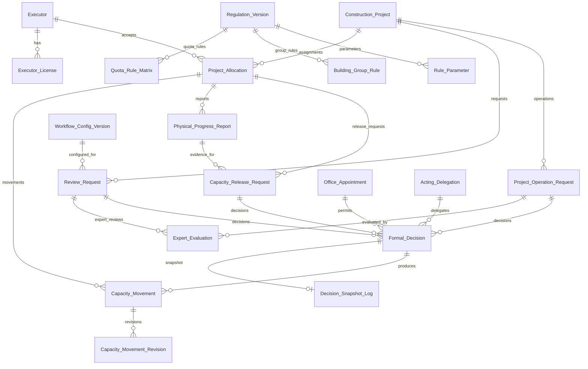

# فرهنگ داده و مدل موجودیت‌های سامانه مدیریت ارجاع کار مجریان ذی‌صلاح

**بهره‌بردار هدف:** کارگروه مجریان ذی‌صلاح، دفتر نمایندگی سازمان نظام مهندسی ساختمان دزفول  
**شناسه سند:** `DD-SCHEMA-DEZ-04`  
**نسخه:** `0.4-draft`  
**وضعیت:** پیش‌نویس طراحی منطقی برای بازبینی مالک محصول؛ نه طرح نهایی بانک اطلاعاتی و نه مجوز اجرای ضوابط قانونی  
**تاریخ:** ۱۴۰۵/۰۸/۲۸، برابر با ۱۹ نوامبر ۲۰۲۶  
**اسناد مبنا:** `Data Dictionary & Entity Schema - Comprehensive.md` (نسخه ۳)، `Dezful_Executor_System_Decision_Register_v01.md`، `Business_Rules_Specification_Dezful_MVP_v04_Draft.md`، سند درک مسئله نسخه ۲، سند گردش صفحات و سند پشته فناوری.  
**وضعیت فایل‌های مبنا:** بدون تغییر؛ این سند **فایل جدید و مستقل** است.

> **نحوه خواندن:** عبارت «قطعی» به معنی *تصمیم محصول مطابق گفت‌وگو* است، نه تأیید حقوقی. عبارت «پیشنهاد طراحی» تعهد تصویب‌شده کارفرما محسوب نمی‌شود و در بازبینی فنی قابل تغییر است. برای فیلدهای قانونی، مقادیر پیش‌فرض ساختگی تعریف نشده‌اند. **آستانه ۸۰٪ و اختیارات تأیید استثنایی تا دریافت مستند معتبر، سیاست عملیاتیِ نیازمند تأیید قانونی باقی می‌مانند.**

## ۱. دامنه و اصول طراحی

1. نسخه اول **تک‌دفتر و تک‌شهر** است؛ نیازی به موجودیت `Tenant`، گردش کار پویای عمومی، پورتال مالک/مجری یا نقش داخلی بازرس نیست. تعداد کاربران در شروع: یک رئیس دفتر، یک کارشناس ثبت درخواست، یک کارشناس بررسی و یک مدیر سیستم؛ این تعداد نباید قید سخت پایگاه داده شود (`DEC-S-01..04`).
2. میان **پروژه**، **درخواست**، **تخصیص**، **مسئولیت مجری** و **اشغال ظرفیت** تمایز وجود دارد. آزادسازی ظرفیت پروژه را مختومه و مسئولیت مجری را خاتمه نمی‌دهد (`DEC-Q-10`, `DEC-L-09`).
3. تأیید نهایی یک رویداد کسب‌وکار مستقل است و باید به صاحب منصب رئیس دفتر یا جانشین معتبر نسبت داده شود؛ اعطای نقش `RBAC` به‌تنهایی کافی نیست (`DEC-S-05..08`).
4. مشخصات تاریخی تصمیم و نسخه قواعد باید تغییرناپذیر باشند. داده‌های پیش‌نویس فاقد سابقه رسمی با مجوز مناسب قابل حذف‌اند، ولی داده‌های تصویب‌شده و اثرات ظرفیت حذف دائمی نمی‌شوند (`DEC-F-06/07`).
5. مقدار ظرفیت از **مانده اشغال تخصیص‌ها و اصلاحات تأییدشده اولیه** استخراج می‌شود، نه از شمار پروژه‌های دارای وضعیت اجرایی فعال. کاهش یا افزایش سقف مجاز یک رویداد مستقل از تغییر مصرف ظرفیت است.
6. مدل **منطقی** معرفی می‌شود. یک موجودیت منطقی الزاماً یک جدول فیزیکی مستقل نمی‌طلبد؛ نگاشت نهایی باید در طراحی `Entity Framework Core` همراه با مهاجرت‌های پایگاه داده تأیید شود. از جدول‌های بی‌مصرفِ مخصوص نسخه‌های آینده اجتناب می‌کنیم.

### ۱.۱. استاندارد داده و نام‌گذاری پیشنهادی

| موضوع | قرارداد پیشنهادی |
|---|---|
| شناسه‌ها | کلید اصلی `uniqueidentifier` با نام `*_id`؛ کلیدهای خارجی هم‌نوع و دارای ایندکس |
| متراژ | `decimal(18,2)`؛ هیچ متراژ یا تغییر متراژ عملیاتی از `float` استفاده نکند |
| پیشرفت فیزیکی | `decimal(5,2)` در بازه `0..100`؛ برای فرمول، تقسیم بر `100` انجام شود |
| تعداد سهمیه کار | `int`، با مانده اشغال تخصیص برابر `0` یا `1`؛ ظرفیت آزاد کلی می‌تواند منفی باشد |
| زمان رویداد | `datetimeoffset(7)` و نگهداری ساعت دقیق؛ تاریخ مؤثر ضوابط مطابق **تاریخ محلی دزفول/ایران** تفسیر شود |
| تاریخ مندرج در سند رسمی | `date` با تعریف روشن نوع تاریخ و تبدیل صحیح تقویم در رابط فارسی |
| متن فارسی و کدها | `nvarchar(n)`؛ برای کدهای ملی/پروانه/شهرداری از رشته استفاده شود تا صفر ابتدایی حذف نشود |
| داده JSON | `nvarchar(max)` با اعتبارسنجی ساختار و `CHECK (ISJSON(...) = 1)` در صورت نیاز؛ جایگزین ستون‌های رابطه‌ای اصلی نشود |
| کنترل هم‌زمانی | ستون `row_version rowversion` برای رکوردهای قابل ویرایش و کنترل نسخه در `EF Core` |
| وضعیت‌های عملیاتی | مقادیر مجاز مشخص و مستند؛ نمایش فارسی در رابط، شناسه ثابت انگلیسی در داده |
| حذف | `NoAction/Restrict` برای تصمیم‌ها و حسابرسی؛ حذف آبشاری فقط برای زیرمجموعه پیش‌نویسِ واقعاً بدون ارجاع رسمی |
| فایل‌ها | ذخیره محتوا در مخزن فایل کنترل‌شده و نگهداری مسیر نسبی، نوع، اندازه و `SHA-256` در بانک اطلاعاتی؛ فایل به‌تنهایی مدرک تأییدشده نیست |

### ۱.۲. واژگان و فرمول‌های اصلی

- `Max_Area` و `Max_Jobs`: سقف مجاز از ضابطه معتبر + وضعیت تأییدشده مجری.
- `Used_Area`: جمع مانده تغییرات مثبت و منفی **مؤثر** در `Capacity_Movement` برای مجری، شامل اصلاحیه افتتاحیه تأییدشده.
- `Used_Jobs`: جمع تغییرات سهمیه کار مؤثر در همان دفتر؛ ممکن است از تعداد پروژه‌های در حال اجرا کمتر باشد.
- `Free_Area = Max_Area - Used_Area` و `Free_Jobs = Max_Jobs - Used_Jobs`؛ **منفی‌شدن ظرفیت آزاد ممکن است**.
- `Effective_Area` برای تخصیص پروژه نوساز، متراژ کل؛ برای **مجری جایگزین** `Project_Area × (1 − P_handover/100)` است. محاسبه پروژه نیمه‌کاره فاقد سابقه تخصیص در سامانه **هنوز تعیین‌تکلیف نشده** (`OPEN-DATA-01`).
- `Replacement_Work_Progress = (Current_Progress − P_handover) / (100 − P_handover) × 100`، برای `P_handover < 100`.
- `Release_Threshold` تنظیم‌پذیر، مقدار عملیاتی پیش‌نویس ۸۰٪، **مشروط به تأیید قانونی**. پس از رسیدن به آستانه و *تأیید صریح رئیس دفتر*، تمام مانده متراژ و سهمیه کار تخصیص یک‌بار آزاد می‌شوند.

## ۲. فهرست موجودیت‌ها و وضعیت نسخه‌ها

**شناسه‌های `ENT-01` تا `ENT-10` سند اصلی حفظ شده‌اند.** شناسه‌های جدید از `ENT-16` آغاز می‌شوند؛ شناسه‌های `ENT-11` تا `ENT-15` برای نسخه‌های آینده رزرو هستند. جدول زیر **فهرست موجودیت‌های منطقی** است و نباید صرفاً بر مبنای تعداد ردیف‌ها درباره تعداد جدول فیزیکی داوری کرد.

| شناسه | موجودیت / نام منطقی | حوزه | وضعیت |
|---|---|---|---|
| `ENT-01` | پرونده مجری ـ `Executor` | مجری | حفظ و اصلاح |
| `ENT-02` | پروانه تأییدشده ـ `Executor_License` | مجری | حفظ و اصلاح |
| `ENT-03` | عضو امتیازآور شرکت ـ `Company_Key_Member` | مجری | حفظ و اصلاح |
| `ENT-04` | محدودیت قانونی/انضباطی ـ `Disciplinary_Record` | مجری | حفظ و اصلاح |
| `ENT-05` | نسخه سند قانونی ـ `Regulation_Version` | ضوابط | حفظ و اصلاح |
| `ENT-06` | ماتریس سقف و صلاحیت ـ `Quota_Rule_Matrix` | ضوابط | حفظ و اصلاح |
| `ENT-07` | پروژه ـ `Construction_Project` | پروژه | حفظ و اصلاح |
| `ENT-08` | تخصیص مجری ـ `Project_Allocation` | تخصیص | حفظ و اصلاح |
| `ENT-09` | تصویر لحظه‌ای تصمیم ـ `Decision_Snapshot_Log` | حسابرسی | حفظ و تکمیل |
| `ENT-10` | جدول گروه ساختمان ـ `Building_Group_Rule` | ضوابط | حفظ و اصلاح |
| `ENT-16` | درخواست ارجاع اصلی ـ `Review_Request` | درخواست | جدید |
| `ENT-17` | ارزیابی کارشناسی ـ `Expert_Evaluation` | بررسی | جدید |
| `ENT-18` | تصمیم رسمی ـ `Formal_Decision` | تصمیم | جدید |
| `ENT-19` | گردش ظرفیت ـ `Capacity_Movement` | ظرفیت | جدید |
| `ENT-20` | گزارش پیشرفت ثبت‌شده ـ `Physical_Progress_Report` | پروژه | جدید |
| `ENT-21` | درخواست آزادسازی ـ `Capacity_Release_Request` | ظرفیت | جدید |
| `ENT-22` | درخواست عملیات پروژه ـ `Project_Operation_Request` | پروژه | جدید |
| `ENT-23` | مدرک و فایل ـ `Document_Record` | اسناد | جدید |
| `ENT-24` | اقلام چک‌لیست مدارک ـ `Document_Check_Item` | اسناد | جدید |
| `ENT-25` | نسخه فرم پذیرش مسئولیت ـ `Acceptance_Form_Version` | اسناد | جدید |
| `ENT-26` | قالب فرم ـ `Form_Template` | اسناد | جدید |
| `ENT-27` | نسخه تنظیمات گردش کار ـ `Workflow_Config_Version` | گردش کار | جدید |
| `ENT-28` | تغییر پیشنهادی پروانه ـ `License_Change_Request` | مجری | جدید |
| `ENT-29` | تغییر عضویت امتیازآور ـ `Member_Change_Request` | مجری | جدید |
| `ENT-30` | تأیید افتتاحیه ظرفیت مجری ـ `Opening_Capacity_Verification` | مهاجرت | جدید |
| `ENT-31` | دسته ورود اکسل ـ `Import_Batch` | مهاجرت | جدید |
| `ENT-32` | نتیجه سطر ورود ـ `Import_Row_Result` | مهاجرت | جدید |
| `ENT-33` | انتصاب رئیس دفتر ـ `Office_Appointment` | اختیار | جدید |
| `ENT-34` | تفویض موقت اختیار ـ `Acting_Delegation` | اختیار | جدید |
| `ENT-35` | مجوزها و انتساب نقش‌ها ـ `Access_Control` | امنیت | جدید؛ با زیرساخت استاندارد هویت |
| `ENT-36` | رخداد حسابرسی ـ `Audit_Event` | حسابرسی | جدید |
| `ENT-37` | اعلان داخلی ـ `Notification` | کارتابل | جدید؛ ساده |
| `ENT-38` | استثنای تصمیم ـ `Decision_Override` | تصمیم | جدید؛ مشروط به قانونی‌بودن |
| `ENT-39` | تاریخچه اصلاح گردش ظرفیت ـ `Capacity_Movement_Revision` | ظرفیت | جدید |
| `ENT-40` | پارامتر نسخه ضابطه ـ `Rule_Parameter` | ضوابط | جدید؛ سبک |

**موجودیت‌های نسخه‌های بعدی، بدون ساخت جدول بلااستفاده در MVP:** `ENT-11 Project_Contract`، `ENT-12 Portal_User`، `ENT-13 SMS_Log`، `ENT-14 Workshop_Inspection`، `ENT-15 External_Sync_Log`. این شناسه‌ها صرفاً برای تداوم سازگاری با سند اصلی حفظ می‌شوند.

## ۳. فرهنگ داده هسته نسخه اول

**قاعده عمومی برای جداول قابل ویرایش:** مگر جایی که استثنا ذکر شود، ستون‌های `created_at`, `created_by_user_id`, `updated_at`, `updated_by_user_id`, `row_version` در پیاده‌سازی لحاظ شوند. کلیدهای کاربران به شناسه پایدار حساب کاربری داخلی ارجاع داده شوند. در جداول رخداد تغییرناپذیر، `updated_*` و `row_version` لازم نیست.

### ۳.۱. مجریان، پروانه و عضویت حقوقی

#### `ENT-01` ـ `Executor`

| فیلد کلیدی | نوع پیشنهادی | شرح / قید |
|---|---|---|
| `executor_id` | `uniqueidentifier PK` | شناسه مستقل مجری |
| `entity_type` | `nvarchar(16)` | `INDIVIDUAL` یا `LEGAL` |
| `full_name` | `nvarchar(200)` | نام/عنوان رسمی |
| `national_identifier` | `nvarchar(11)` | کد ملی ۱۰ رقمی یا شناسه ملی ۱۱ رقمی؛ کنترل نوع و یکتایی |
| `membership_no` | `nvarchar(50)` | شماره عضویت، یکتا در محدوده دفتر در صورت احراز کیفیت داده |
| `membership_status` | `nvarchar(24)` | فعال/غیرفعال/تعلیق؛ مستقل از بلوکه‌شدن موقت پذیرش کار |
| `allowed_zone` | `nvarchar(150)` | محدوده فعالیت طبق مستند؛ در MVP داده پیکربندی/کنترل و نه مدل GIS |
| `opening_verification_status` | `nvarchar(30)` | `PENDING`, `APPROVED`, `NEEDS_CORRECTION` |
| `contact_phone` | `nvarchar(20) NULL` | اطلاعات تماس |

**تغییر نسبت به سند اصلی:** مقادیر `current_used_area`, `current_active_jobs`, `current_free_area` **منبع حقیقت و قابل ویرایش مستقیم نیستند**؛ از گردش ظرفیت استخراج می‌شوند. سقف‌های جاری نیز بر اساس نسخه ضوابط و وضعیت تأییدشده محاسبه می‌شوند. در صورت نیاز برای سرعت، نمای خواندنی یا کش قابل بازسازی به کار می‌رود. منع تخصیص جدید می‌تواند حاصل چند علت هم‌زمان باشد: پروانه نامعتبر، تغییر تأییدنشده، اصلاح افتتاحیه یا محدودیت انضباطی؛ یک پرچم دستیِ مستقل نباید این دلایل را پنهان کند.

#### `ENT-02` ـ `Executor_License`

`license_id uniqueidentifier PK`، `executor_id FK`، `license_number nvarchar(50)`، `issuing_authority nvarchar(100)`، `discipline nvarchar(32)`، `has_execution_qual bit`، `grade_level nvarchar(32)`، `issue_date date`، `expiry_date date`، `verification_ref nvarchar(100) NULL`، `effective_from date`، `effective_to date NULL`، `approval_decision_id FK NULL`.

- فقط اطلاعات **تصویب‌شده** به عنوان پروانه مؤثر در ارزیابی انتخاب می‌شوند.
- سوابق پروانه با پایان‌بندی اعتبار نگهداری شوند؛ تغییر درحال‌بررسی در `ENT-28` است، نه بازنویسی بی‌سابقه پروانه فعال.
- منع تخصیص ناشی از تغییر در حال بررسی، حتی بعد از رد، تا تصویب اصلاح معتبر باقی می‌ماند (`DEC-Q-07`).
- اعتبار آخرین روز پروانه و نوع تاریخ مطابق مستند قانونی در دروازه تأیید حقوقی نهایی شود.

#### `ENT-03` ـ `Company_Key_Member`

`member_id PK`، `company_executor_id FK(Executor)`، `member_person_executor_id FK(Executor) NULL`، `member_national_code nvarchar(10)`، `member_full_name nvarchar(150)`، `company_role nvarchar(32)`، `member_grade nvarchar(32)`، `contributed_area decimal(18,2) NULL`، `valid_from date`، `valid_to date NULL`، `approval_decision_id FK`.

- فقط رکوردهای تأییدشده با بازه فعال در محاسبه امتیاز حقوقی مشارکت کنند.
- عضویت امتیازآور فعال یک کد ملی در **دو شرکت** نباید بازه‌های زمانی همپوشان داشته باشد؛ کنترل در تراکنش تأیید و با قفل مناسب الزامی است، چون `UNIQUE` ساده به‌تنهایی همپوشانی بازه‌ها را حل نمی‌کند.
- در صورت شناسایی شخص به عنوان مجری حقیقی، پذیرش عضویت امتیازآور با تخصیص فردی دارای مسئولیت جاریِ تعیین‌تکلیف‌نشده ممنوع است.
- تغییر پیشنهادی در `ENT-29`، تغییر قطعی در این موجودیت پس از تأیید رئیس دفتر اعمال می‌شود.

#### `ENT-04` ـ `Disciplinary_Record`

`record_id PK`، `executor_id FK`، `restriction_type nvarchar(32)`، `ruling_number nvarchar(50)`، `start_date date`، `end_date date NULL`، `blocks_new_work bit`، `legal_reference_id FK(Regulation_Version) NULL`، `evidence_document_id FK(Document_Record) NULL`، `status nvarchar(20)`.

سوابق رسمی مستقل از انقضای پروانه و از وضعیت ارجاع نگهداری شوند؛ تنها احکام/محدودیت‌های معتبر در بازه مؤثر موجب منع تخصیص جدید شوند. تعارض `HSE_RED_ALERT` با محدوده واقعی MVP باید با مرجع حقوقی بررسی شود؛ نقش بازرسی میدانی در نسخه اول وجود ندارد.

### ۳.۲. مصوبات، سقف‌ها و پارامترها

#### `ENT-05` ـ `Regulation_Version`

`regulation_id PK`، `regulation_code nvarchar(50)`، `title nvarchar(200)`، `issuing_body nvarchar(150)`، `reference_no nvarchar(100)`، `issued_on date`، `effective_from date`، `effective_to date NULL`، `status nvarchar(20)` (`DRAFT`, `ACTIVE`, `ARCHIVED`)، `jurisdiction nvarchar(80)`، `source_document_id FK(Document_Record) NULL`، `activated_at datetimeoffset NULL`، `activated_by_user_id FK`.

**قید:** نسخه فعال برای **یک نوع قاعده و حوزه اعمال** نباید در بازه اجرا تعارض حل‌نشده داشته باشد. اصلاح پس از فعال‌سازی به صورت نسخه جدید باشد؛ تصمیمات پیشین با نسخه قبلی ثابت بمانند.

#### `ENT-06` ـ `Quota_Rule_Matrix`

`rule_matrix_id PK`، `regulation_id FK`، `target_entity_type nvarchar(16)`، `target_grade_level nvarchar(32)`، `company_calc_mode nvarchar(24)`، `rule_max_area decimal(18,2) NULL`، `rule_max_jobs int NULL`، `rule_single_proj_cap decimal(18,2) NULL`، `rule_max_pos_floors int NULL`، `rule_max_neg_floors int NULL`، `allowed_building_groups nvarchar(100)`، `allowed_zones nvarchar(300) NULL`، `requires_legal_entity bit NULL`.

- `NULL` به معنی «در این منبع، حکم مشخصی ثبت نشده» است، نه مجازبودن نامحدود؛ تصمیم ارزیابی باید قاعده مورد نیاز را یافته باشد.
- ضریب محاسبه شرکت، سهم اعضا و محدودیت‌های انضباطی تنها اگر مستند معتبر وجود داشته باشد اجرا شوند.
- «قابل عدول بودن» در `ENT-40 Rule_Parameter` به‌ازای **کد قاعده و نسخه معتبر** نگهداری می‌شود و فقط همراه با مبنای اختیار/مصوبه فعال است؛ صرف تنظیم توسط مدیر سیستم اختیار حقوقی نمی‌آفریند.

#### `ENT-10` ـ `Building_Group_Rule`

`group_rule_id PK`، `regulation_id FK`، `building_group_code nvarchar(12)`، `severity_rank int`، `min_pos_floors int NULL`، `max_pos_floors int NULL`، `min_gross_area decimal(18,2) NULL`، `max_gross_area decimal(18,2) NULL`، `requires_legal_entity bit NULL`.

**اصلاح قطعی:** گروه ساختمانی رسمی ثبت‌شده در مدرک شهرداری ملاک ارزیابی است؛ مقدار محاسباتی تنها برای تشخیص مغایرت نگهداری شود. قید قدیمیِ «گروه نهایی همیشه بزرگ‌ترین گروه» **حذف می‌شود**. مغایرت، تأیید مستند رئیس دفتر می‌خواهد (`DEC-Q-03`).

#### `ENT-40` ـ `Rule_Parameter`

`parameter_id PK`، `regulation_id FK`، `rule_code nvarchar(64)`، `parameter_key nvarchar(100)`، `value_type nvarchar(20)`، `value_text nvarchar(max)`، `legal_basis_document_id FK(Document_Record) NULL`، `is_overrideable bit NULL`، `effective_from date`، `effective_to date NULL`.

این موجودیت مکمل **سبک** ماتریس ثابت است؛ نمونه کلیدها: `Release_Threshold`, `Release_Area_Mode`, `Release_Job_Mode`, `Allow_Override_For_Rule`. از ثبت دوباره همین کلید در منابع ناسازگار جلوگیری شود. مقدار پیش‌نویس آستانه ۸۰٪ است و **بدون مستند معتبر نباید به‌عنوان حکم لازم‌الاجرا به بهره‌بردار ارائه شود**.

### ۳.۳. پروژه و تخصیص مجری

#### `ENT-07` ـ `Construction_Project`

| فیلد | نوع | کارکرد |
|---|---|---|
| `project_id` | `uniqueidentifier PK` | هویت پایدار ساختمان در کل عمر فرایند |
| `municipal_file_no` | `nvarchar(100)` | شماره پرونده شهرداری؛ کلید اصلی کشف تکرار |
| `cadastral_ref` | `nvarchar(100) NULL` | پلاک ثبتی برای کشف شباهت |
| `renovation_code` | `nvarchar(100) NULL` | کد نوسازی برای کشف شباهت |
| `owner_name` | `nvarchar(200)` | نام مالک/متقاضی؛ بدون ایجاد پورتال |
| `owner_national_id` | `nvarchar(11) NULL` | با اعتبارسنجی نوع شخص |
| `project_zone` | `nvarchar(150)` | محل/محدوده پروژه |
| `address` | `nvarchar(500) NULL` | نشانی ملک |
| `total_gross_area` | `decimal(18,2)` | متراژ فعلی رسمی پروژه |
| `positive_floors`, `negative_floors` | `int` | شمار طبقات ثبت‌شده از مدرک رسمی |
| `declared_building_group` | `nvarchar(12)` | گروه درج‌شده در مدرک شهرداری؛ ملاک کار |
| `calculated_building_group` | `nvarchar(12) NULL` | گروه استنتاج‌شده؛ صرفاً نشانگر اختلاف |
| `group_mismatch_decision_id` | `FK Formal_Decision NULL` | تصمیم رئیس دفتر در صورت مغایرت |
| `usage_type` | `nvarchar(32)` | مسکونی/تجاری/مختلط/… طبق فهرست کنترل‌شده |
| `physical_status` | `nvarchar(32)` | `PENDING_ALLOCATION`, `ACTIVE`, `SUSPENDED`, `WAITING_REPLACEMENT`, `COMPLETED` |
| `approved_progress_pct` | `decimal(5,2)` | آخرین پیشرفت معتبر مبنا، مستقل از گزارش‌های اطلاع‌رسانی کمتر |
| `created_as_legacy` | `bit` | نشان‌دهنده ورود تاریخی/افتتاحیه |

شماره پرونده شهرداری پس از نرمال‌سازی تا حد اعتبار داده **برای پروژه‌های یکسان** تکرار نشود؛ برای پروژه‌های با شماره متفاوت و شناسه ملک مشابه، سیستم فقط پس از تأیید مستند رئیس دفتر اجازه ادامه می‌دهد. سوابق اصلاح متراژ از طریق `ENT-22`, `ENT-18`, `ENT-36` باقی می‌مانند؛ `initial_progress` و `effective_area` **نباید به‌عنوان حقیقت مشترک تمام تخصیص‌های متوالی در پروژه ذخیره شوند**.

#### `ENT-08` ـ `Project_Allocation`

| فیلد | نوع | کارکرد |
|---|---|---|
| `allocation_id` | `uniqueidentifier PK` | هر نوبت مسئولیت یک مجری؛ تغییر مجری = تخصیص جدید |
| `project_id` | `FK Construction_Project` | یک پروژه، چند تخصیص تاریخی |
| `executor_id` | `FK Executor` | مجری این نوبت |
| `review_request_id` | `FK Review_Request NULL` | مبنای تخصیص اولیه یا جایگزین |
| `approval_decision_id` | `FK Formal_Decision` | تأیید نهایی صاحب اختیار |
| `selection_mode` | `nvarchar(20)` | `VALIDATION` یا `RECOMMENDATION` |
| `start_at` | `datetimeoffset` | لحظه تخصیص قطعی، نه زمان درخواست |
| `end_at` | `datetimeoffset NULL` | پایان رسمی مسئولیت؛ مستقل از آزادشدن ظرفیت |
| `handover_progress_pct` | `decimal(5,2)` | درصد مصوب پیشرفت هنگام تحویل به این مجری |
| `initial_blocked_area` | `decimal(18,2)` | متراژ اشغال‌شده اولیه در این تخصیص |
| `allocation_status` | `nvarchar(32)` | `RESPONSIBLE`, `TERMINATED`, `COMPLETED`؛ **وضعیت ظرفیت نیست** |
| `is_legacy_allocation` | `bit` | سوابق وارده در افتتاحیه |
| `opening_evidence_status` | `nvarchar(24) NULL` | `VERIFIED_RELEASED`, `VERIFIED_BLOCKED`, `UNKNOWN_BLOCKED` |

**اصل:** هر پروژه در هر لحظه حداکثر **یک تخصیص دارای مسئولیت جاری** داشته باشد. آن تخصیص پس از آزادسازی ناشی از پیشرفت می‌تواند `RESPONSIBLE` بماند، ولی مانده ظرفیتش صفر باشد. `is_occupying_job_slot` و `current_blocked_area` فقط به‌عنوان **نمای محاسباتی** از `ENT-19` عرضه شوند؛ در صورت کش‌سازی باید در همان تراکنش ظرفیت به‌روز شوند و قابلیت بازسازی داشته باشند.

### ۳.۴. درخواست، بررسی و تصمیم

#### `ENT-16` ـ `Review_Request`

`request_id PK`، `project_id FK`، `request_kind nvarchar(20)` (`INITIAL`, `REPLACEMENT`)، `selection_mode nvarchar(20)`، `nominated_executor_id FK NULL`، `proposed_executor_id FK NULL`، `registrar_user_id FK`، `assigned_expert_user_id FK NULL`، `workflow_config_version_id FK`، `status nvarchar(32)`، `submitted_at datetimeoffset NULL`، `assigned_at datetimeoffset NULL`، `closed_at datetimeoffset NULL`، `return_reason nvarchar(1000) NULL`.

- مراحل نمونه: `DRAFT → SUBMITTED_TO_HEAD → ASSIGNED_TO_EXPERT → EXPERT_SUBMITTED → APPROVED / REJECTED`؛ مسیر `RETURNED_FOR_CORRECTION → SUBMITTED_TO_HEAD` و `WAITING_CAPACITY` نیز وجود دارد. **ماتریس گذار نهایی در سند جریان‌ها تکمیل شود**.
- برای یک پروژه فقط **یک `Review_Request` اصلی باز** مجاز است؛ بسته‌شده‌ها تاریخچه باقی بمانند. این قید **شامل درخواست آزادسازی/تغییر متراژ/خاتمه نمی‌شود**.
- در مدل ثابت MVP، رئیس دفتر می‌تواند بررسی را به مسئول جدید ارجاع دهد؛ نتیجه نهاییِ ارسال‌شده باید صراحتاً توسط کارشناس فعلی تأیید شود؛ سابقه کارشناس قبلی حذف نشود.
- «رد قطعی» بسته‌شدن همین درخواست است؛ تلاش مجدد نیازمند درخواست جدید خواهد بود.

#### `ENT-17` ـ `Expert_Evaluation`

`evaluation_id PK`، `review_request_id FK NULL`، `project_operation_request_id FK NULL`، `evaluator_user_id FK`، `evaluated_executor_id FK NULL`، `evaluated_at datetimeoffset`، `regulation_version_id FK`، `project_inputs_json nvarchar(max)`، `eligibility_result_json nvarchar(max)`، `capacity_result_json nvarchar(max)`، `recommendation nvarchar(32)`، `rationale nvarchar(max)`، `is_final_submission bit`، `submitted_at datetimeoffset NULL`.

وجود `review_request_id` و `project_operation_request_id` به‌صورت **انحصاری**: دقیقاً یکی مقدار دارد. هر درخواست می‌تواند چند ارزیابی تاریخی داشته باشد، ولی فقط **ارزیابی تأییدشده مسئول فعلی** مبنای ارسال نهایی است. نتیجه کارشناسی به‌تنهایی ظرفیت را تغییر نمی‌دهد و در زمان تأیید رئیس دفتر دوباره سنجیده می‌شود.

#### `ENT-18` ـ `Formal_Decision`

`decision_id PK`، `decision_type nvarchar(40)`، `outcome nvarchar(24)` (`APPROVED`, `REJECTED`, `RETURNED`, `CANCELLED`, `DEFERRED` در موارد مجاز)، `actor_user_id FK`، `office_appointment_id FK NULL`، `acting_delegation_id FK NULL`، `decision_at datetimeoffset`، `reason nvarchar(max) NULL`، `regulation_version_id FK NULL`، `workflow_config_version_id FK NULL`، `idempotency_key nvarchar(120)`، `subject_*_id FK NULL`.

**پیوند موضوع تصمیم:** به‌جای `subject_type + subject_id` بدون کلید خارجی، در طرح فیزیکی پیشنهادی ستون‌های خارجیِ nullable برای `review_request_id`, `project_operation_request_id`, `capacity_release_request_id`, `progress_report_id`, `license_change_request_id`, `member_change_request_id`, `opening_verification_id` و در صورت نیاز `project_id` قرار گیرند؛ **دقیقاً یکی** برای هر تصمیم مقدار داشته باشد (قید `CHECK`). این طرح شمار اندکی ستون nullable می‌افزاید ولی یکپارچگی ارجاعی را حفظ می‌کند. اگر در فاز پیاده‌سازی روش ساده‌تر و امن‌تری با همان سطح یکپارچگی پیشنهاد شود، نیازمند بازبینی فنی است.

- **هر تصمیم نهایی مؤثر بر ظرفیت** باید در همان تراکنش رویداد ظرفیت را ایجاد کند.
- تصمیم‌های ثبت بازگشت/رد برای حسابرسی قابل ثبت هستند ولی اشغال/آزادسازی ندارند.
- فقط رئیس دفتر منصوب یا جانشین معتبر در محدوده ابلاغ می‌تواند تصمیم نهایی اختصاصی آن سمت را امضا کند؛ نقش ساده `Admin` کافی نیست.
- تصمیم رسمی پس از ثبت **ویرایش یا حذف نمی‌شود**؛ تصحیح از طریق فرایند مستقل مجاز انجام می‌شود.

#### `ENT-09` ـ `Decision_Snapshot_Log`

`snapshot_id PK`، `decision_id FK UNIQUE`، `captured_at datetimeoffset`، `actor_user_id FK`، `project_id FK NULL`، `executor_id FK NULL`، `applied_regulation_id FK NULL`، `rule_matrix_id FK NULL`، `executor_quota_snapshot nvarchar(max)`، `project_params_snapshot nvarchar(max)`، `stages_evaluation_result nvarchar(max)`، `override_details_json nvarchar(max) NULL`، `decision_result nvarchar(40)`، `rationale nvarchar(max)`، `snapshot_schema_version int`، `content_hash nvarchar(64) NULL`.

این موجودیت **فقط افزودنی و تغییرناپذیر** است. حجم اطلاعات JSON باید کافی باشد تا بتوان نتیجه همان روز را بدون رجوع به قواعد امروزی توضیح داد. سابقه یک تصمیم رسمی با اصلاح داده‌های بعدی بازنویسی نشود.

#### `ENT-38` ـ `Decision_Override`

`override_id PK`، `decision_id FK`، `rule_code nvarchar(64)`، `legal_authority_reference nvarchar(200)`، `legal_document_id FK(Document_Record) NULL`، `before_result_json nvarchar(max)`، `reason nvarchar(max)`، `approved_at datetimeoffset`.

وجود این رکورد تنها هنگامی مجاز است که پارامتر نسخه معتبر **عدول از همان قاعده** را با مرجع اختیار واقعی مجاز کرده باشد؛ اعمال یک استثنا به دیگر قواعد تعمیم داده نشود. **اصل امکان‌سنجی حقوقی هنوز باز است** (`OPEN-LAW-02`).

### ۳.۵. ظرفیت و گزارش پیشرفت

#### `ENT-19` ـ `Capacity_Movement`

| فیلد | نوع | معنا |
|---|---|---|
| `movement_id` | `uniqueidentifier PK` | شناسه اثر ظرفیت |
| `executor_id` | `FK Executor` | حساب ظرفیت مجری |
| `allocation_id` | `FK Project_Allocation NULL` | مبنای تخصیص؛ برای اصلاح افتتاحیه سراسری ممکن است خالی باشد |
| `movement_type` | `nvarchar(32)` | `ALLOCATION`, `PROGRESS_RELEASE`, `ALLOCATION_TERMINATION`, `PROJECT_COMPLETION`, `AREA_CHANGE`, `OPENING_BALANCE`, `OPENING_ADJUSTMENT`, `LIMIT_CHANGE` |
| `area_delta` | `decimal(18,2)` | مثبت = اشغال؛ منفی = آزادسازی/کاهش اشغال |
| `job_delta` | `int` | مثبت = اشغال؛ منفی = آزادسازی؛ در رخداد تخصیص حداکثر `1` |
| `effective_at` | `datetimeoffset` | زمان اثر تصمیم تأییدشده؛ عطف‌به‌ماسبق ندارد |
| `formal_decision_id` | `FK Formal_Decision` | مستند صدور/تأیید حرکت |
| `event_key` | `nvarchar(120)` | شناسه پایدار یکتای رویداد، جلوگیری از ثبت تکراری |
| `before_balance_json`, `after_balance_json` | `nvarchar(max)` | تصویر ظرفیت قبل و بعد برای حسابرسی |
| `reason` | `nvarchar(max) NULL` | دلیل اصلاح یا رخداد خاص |
| `movement_version` | `int` | نسخه رکورد برای اصلاح مجاز و ثبت تاریخچه |

- در `LIMIT_CHANGE`، `area_delta=0` و `job_delta=0` است؛ سقف قبلی/جدید در جزئیات و تصویر تصمیم ثبت می‌شود. **تغییر سقف را به اشتباه تغییر مصرف ثبت نکنیم.**
- `OPENING_BALANCE`، مانده واقعاً اشغال‌شده پروژه تاریخی را یک‌بار وارد می‌کند. در سوابق بدون مدرک معتبر آزادسازی: **کل متراژ و یک سهمیه** ثبت شود؛ در پروژه دارای آزادسازی تاریخی تأییدشده، فقط مانده واقعی افتتاحیه ثبت شود.
- برای هر تخصیص، مجموع مانده متراژِ اشغال‌شده و سهمیه اشغال‌شده به‌ترتیب منفی یا کمتر از صفر نشود؛ آزادسازی مجدد همان مانده غیرمجاز است. **منفی‌شدن `Free_Area` در سطح مجری با منفی‌شدن مانده یک تخصیص فرق دارد.**
- ویرایش مستقیم رکورد حرکت **طبق تصمیم محصول مجاز است**، اما قبل/بعد و دلیل در `ENT-39` به‌صورت تغییرناپذیر ذخیره شود. ویرایش نباید `Decision_Snapshot` را تغییر دهد. اعتبارسنجی و بازمحاسبه کل مانده پس از اصلاح لازم است.

#### `ENT-39` ـ `Capacity_Movement_Revision`

`revision_id PK`، `movement_id FK`، `revision_no int`، `old_area_delta decimal(18,2)`، `new_area_delta decimal(18,2)`، `old_job_delta int`، `new_job_delta int`، `old_payload_json nvarchar(max)`، `new_payload_json nvarchar(max)`، `changed_by_user_id FK`، `changed_at datetimeoffset`، `reason nvarchar(max)`، `approval_decision_id FK NULL`.

**فقط افزودنی** با یکتایی `(movement_id, revision_no)`. رکورد جاری ممکن است بر اساس مجوز اصلاح شود، اما تاریخچه قدیمی و تصاویر تصمیم سابق قابل حذف/ویرایش نیستند. روش صدور تأیید برای *نوع خاص اصلاح مستقیم* پیش از کدنویسی نهایی شود؛ `Admin` صرفاً به‌دلیل دسترسی فنی صاحب اختیار تصمیم ظرفیت نیست.

#### `ENT-20` ـ `Physical_Progress_Report`

`report_id PK`، `project_id FK`، `allocation_id FK`، `reporter_name nvarchar(200)`، `reporter_identifier nvarchar(100) NULL`، `report_date date`، `received_at datetimeoffset`، `registered_by_user_id FK`، `progress_pct decimal(5,2)`، `report_reference nvarchar(100) NULL`، `report_status nvarchar(24)` (`DRAFT`, `SUBMITTED`, `APPROVED`, `RETURNED`, `REJECTED`)، `approval_decision_id FK NULL`، `counts_as_official_progress bit`، `comment nvarchar(max) NULL`.

- گزارش مستقل از درخواست آزادسازی است؛ همه گزارش‌ها حتی بعد از آزادسازی کامل ثبت/برای رئیس دفتر ارسال می‌شوند.
- گزارشِ با درصد کمتر از آخرین پیشرفت تأییدشده، بعد از تأیید برای **اطلاع** نگهداری می‌شود و مقدار `approved_progress_pct` اصلی و ظرفیت را کم نمی‌کند.
- بازرس در نسخه اول حساب کاربری ندارد؛ فقط اطلاعات هویتی/مرجع گزارش خارجی ثبت می‌شود.

#### `ENT-21` ـ `Capacity_Release_Request`

`release_request_id PK`، `allocation_id FK`، `project_id FK`، `registered_by_user_id FK`، `base_progress_report_id FK`، `status nvarchar(36)`، `requested_at datetimeoffset`، `head_decision_id FK NULL`، `cancellation_reason nvarchar(max) NULL`، `superseded_by_closure_request_id FK(Project_Operation_Request) NULL`، `reopened_at datetimeoffset NULL`.

وضعیت‌ها: `DRAFT`, `PENDING_HEAD`, `RETURNED`, `DEFERRED`, `CLOSED_BY_CLOSURE`, `APPROVED`, `REJECTED`, `CANCELLED`. تنها یک درخواست در وضعیت فعال (`DRAFT/PENDING_HEAD/RETURNED/DEFERRED`) برای هر تخصیص مجاز است. حالت `CLOSED_BY_CLOSURE` نیز در پیوند خاتمه محفوظ است و **تا تعیین تکلیف خاتمه، نمی‌توان آن را به‌عنوان مجوز ایجاد درخواست آزادسازی تازه تلقی کرد**. تأیید گزارش جدید می‌تواند `base_progress_report_id` را در همان درخواست معوق عوض کند؛ تاریخچه آن در `Audit_Event` باقی بماند. تاریخ گزارش، زمان ثبت و زمان تأیید رئیس دفتر مستقل نگهداری شوند.

#### `ENT-22` ـ `Project_Operation_Request`

`operation_request_id PK`، `project_id FK`، `allocation_id FK NULL`، `operation_type nvarchar(30)` (`AREA_CHANGE`, `ALLOCATION_TERMINATION`, `NORMAL_CLOSURE`)، `registered_by_user_id FK`، `assigned_expert_user_id FK NULL`، `workflow_config_version_id FK`، `status nvarchar(40)`، `submitted_at datetimeoffset NULL`، `proposed_total_area decimal(18,2) NULL`، `reason nvarchar(max)`، `evidence_type nvarchar(50) NULL`، `head_decision_id FK NULL`، `cancelled_at datetimeoffset NULL`.

- `NORMAL_CLOSURE` با گواهی شهرداری یا گزارش رسمی بازرس منصوب کارگروه، **مستقیماً توسط رئیس دفتر** رسیدگی می‌شود؛ مرحله بررسی کارشناس ندارد.
- `AREA_CHANGE` و `ALLOCATION_TERMINATION` مطابق مسیر کارشناسی/تأیید نهایی مصوب‌اند. پس از خاتمه رسمی تخصیص، در صورت نیاز پروژه منتظر جایگزین می‌ماند و `Review_Request` جایگزین در `DRAFT` ساخته می‌شود.
- در زمان **ثبت خاتمه عادی**، درخواست آزادسازی معوق متناظر `CLOSED_BY_CLOSURE` می‌شود. در لغو خاتمه قبل از تصمیم نهایی، همان درخواست بازگشایی؛ در رد قطعی خاتمه، بازگشایی نمی‌شود.
- تا خاتمه عادی در جریان است درخواست جدید مؤثر بر تخصیص/ظرفیت ایجاد نشود؛ در حضور آزادسازی باز، درخواست تغییر مجری/متراژ قابل بررسی ولی تصمیم نهایی آن معلق است.
- درخواست اصلاح متراژ در جریان، با آزادسازی کامل به `SUSPENDED_FULL_RELEASE` منتقل و سپس با **تصمیم صریح رئیس دفتر** رد قطعی می‌شود.
- **اثر متراژ اصلاح‌شده روی مانده اشغال تخصیص در هر وضعیت پیشرفت** هنوز فرمول مصوب تفصیلی ندارد؛ در بخش مسائل باز مشخص شده است.

### ۳.۶. مدارک و فرم رسمی

#### `ENT-23` ـ `Document_Record`

`document_id PK`، `scope_kind nvarchar(24)` (`PROJECT`, `EXECUTOR`, `REGULATION`, `TEMPLATE`, `IMPORT`, `APPOINTMENT`, `OTHER_INTERNAL`)، `project_id FK NULL`، `executor_id FK NULL`، `document_type nvarchar(60)`، `display_name nvarchar(255)`، `reference_no nvarchar(100) NULL`، `document_date date NULL`، `received_date date NULL`، `physical_archive_location nvarchar(255) NULL`، `source_kind nvarchar(24)` (`PHYSICAL_VERIFIED`, `UPLOADED`, `GENERATED`)، `storage_relative_path nvarchar(500) NULL`، `mime_type nvarchar(100) NULL`، `file_size_bytes bigint NULL`، `sha256_hex nvarchar(64) NULL`، `verified_by_user_id FK NULL`، `verified_at datetimeoffset NULL`، `is_current_file bit`.

- یک مدرک می‌تواند **فقط فیزیکی** باشد؛ مسیر فایل و هش لازم نیست، ولی کنترل دریافت/راستی‌آزمایی باید ثبت شود.
- PDF تولیدشده حتماً رکورد فایل دارد؛ نمونه‌ها و فرم‌های قدیمی از حسابرسی بدون دلیل حذف نمی‌شوند.
- مدارک پرونده باید به **پروژه یا مجری** متصل باشند؛ اما مدارک سراسری مانند مستند مصوبه، فایل قالب `DOCX`، پرونده انتصاب/تفویض و فایل ورود `Excel` نباید اجباراً به پروژه‌ای ساختگی وصل شوند. این مدارک از **کلید خارجی صریح در موجودیت مربوط** (`Regulation_Version`, `Form_Template`, `Import_Batch`, `Office_Appointment` و مانند آن) ارجاع می‌گیرند. ارتباط اسناد پرونده با درخواست خاص با FK محدود یا جدول پیوند دارای FK پیاده‌سازی شود؛ هیچ `subject_id` عمومیِ بدون کنترل خارجی برای عملیات حقوقی حساس مبنای تصمیم قرار نگیرد.

#### `ENT-24` ـ `Document_Check_Item`

`check_item_id PK`، `review_request_id FK NULL`، `project_operation_request_id FK NULL`، `report_id FK NULL`، `document_type nvarchar(60)`، `is_required bit`، `is_received bit`، `is_verified bit`، `verified_by_user_id FK NULL`، `verified_at datetimeoffset NULL`، `document_id FK NULL`، `physical_archive_location nvarchar(255) NULL`، `config_version_id FK`.

دقیقاً یک موضوع پرونده باید مشخص باشد. فهرست اقلام در زمان ایجاد درخواست، از نسخه تنظیمات مصوب همان زمان تولید می‌شود؛ تغییر تنظیمات جدید نباید چک‌لیست پرونده قبلی را غافلگیرانه عوض کند. اسکن مدرک عمومی لازم نیست؛ **بررسی دریافت و تأیید** در چک‌لیست کفایت می‌کند، مگر برای فرم پذیرش که اصل امضای رسمی باید احراز شود.

#### `ENT-26` ـ `Form_Template`

`template_id PK`، `template_code nvarchar(40)`، `template_version int`، `docx_document_id FK(Document_Record)`، `status nvarchar(20)`، `effective_from datetimeoffset`، `uploaded_by_user_id FK`، `uploaded_at datetimeoffset`؛ یکتایی `(template_code, template_version)`.

قالب `DOCX` توسط مدیر سیستم بارگذاری/جایگزین می‌شود؛ نسخه قدیمی قالب برای توضیح سابقه تولید فرم از نظر شناسه قابل ردیابی باشد.

#### `ENT-25` ـ `Acceptance_Form_Version`

`form_version_id PK`، `project_id FK`، `review_request_id FK NULL`، `allocation_id FK NULL`، `executor_id FK`، `template_id FK NULL`، `pdf_document_id FK NULL`، `version_no int`، `source_mode nvarchar(20)` (`GENERATED`, `EXTERNAL`)، `form_status nvarchar(28)` (`PREPARED`, `PRINTED`, `SIGNED_VERIFIED`, `SUPERSEDED`)، `signature_verified_by_user_id FK NULL`، `signature_verified_at datetimeoffset NULL`، `supersedes_form_version_id FK NULL`، `change_reason nvarchar(max) NULL`.

- **تمام تخصیص‌ها** باید قبل از ارسال برای تأیید نهایی یک فرم پذیرش با وضعیت `SIGNED_VERIFIED` داشته باشند؛ داشتن PDF تولیدشده به‌تنهایی به معنی دریافت امضا نیست.
- پس از تغییر متن فرم امضاشده، فرم تازه به **امضای مجدد** نیاز دارد؛ سابقه نسخه‌ها و تغییرات قابل ردیابی باشد.
- اصلاح صرفاً شکلی پس از تصویب تخصیص، اگر داده‌های مبنای صلاحیت/ظرفیت را تغییر ندهد، نیازی به تأیید مجدد رئیس دفتر ندارد؛ تغییر ماهوی مسیر مستقل می‌خواهد.
- الزام نگهداری *بایت فایل امضاشده قدیمی* در MVP هنوز مصوب نیست؛ ثبت شناسنامه نسخه و تاریخچه الزامی است (`OPEN-RISK-01`).

### ۳.۷. تنظیمات گردش کار، نقش‌ها، انتصاب و اعلان

#### `ENT-27` ـ `Workflow_Config_Version`

`config_version_id PK`، `workflow_code nvarchar(48)`، `version_no int`، `effective_from datetimeoffset`، `effective_to datetimeoffset NULL`، `status nvarchar(20)`، `required_documents_json nvarchar(max)`، `responsible_role_rules_json nvarchar(max)`، `approval_conditions_json nvarchar(max)`، `created_by_user_id FK`.

فقط **تنظیمات محدود** مراحل ثابت در این جدول نگهداری شوند. نمودار مرحله‌ها یا موتور عمومی گردش کار در MVP ایجاد نشود. هر درخواست/عملیات در زمان ایجاد، `config_version_id` خود را حفظ می‌کند؛ قواعد قانونی/ظرفیت در لحظه تصمیم با **نسخه ضابطه مؤثر روز تصمیم** بررسی می‌شوند.

#### `ENT-33` ـ `Office_Appointment`

`appointment_id PK`، `position_code nvarchar(32)` (`OFFICE_HEAD`)، `user_id FK`، `official_letter_no nvarchar(100)`، `effective_from datetimeoffset`، `effective_to datetimeoffset NULL`، `recorded_by_user_id FK`، `document_id FK NULL`، `status nvarchar(20)`.

برای هر لحظه دقیقاً **حداکثر یک متصدی اصلی معتبر** در جایگاه رئیس دفتر. تغییر متصدی، پرونده‌های منتظر تصمیم آن جایگاه را به صورت **نمای کارتابلی** در اختیار فرد جدید قرار می‌دهد؛ نیازی به انتساب تک‌تک درخواست‌ها نیست.

#### `ENT-34` ـ `Acting_Delegation`

`delegation_id PK`، `acting_user_id FK`، `issuing_authority nvarchar(200)`، `letter_no nvarchar(100)`، `document_id FK NULL`، `valid_from datetimeoffset`، `valid_to datetimeoffset`، `scope_json nvarchar(max)`، `recorded_by_user_id FK`، `status nvarchar(20)`.

در MVP **حداکثر یک جانشین فعال** در هر لحظه، با مدت و محدوده اختیار مستند؛ رئیس دفتر اختیار موازی خود را حفظ می‌کند. محدودیت عدم همپوشانی بازه‌ها باید هنگام ثبت/فعال‌سازی با قفل تراکنشی بررسی شود؛ `UNIQUE` ساده روی وضعیت کافی نیست.

#### `ENT-35` ـ `Access_Control`

این عنوان یک **خوشه کوچک جداول استاندارد** است، نه الزام به ساخت یک جدول غیرطبیعی: حساب‌های `ASP.NET Core Identity`، نقش، انتساب چندنقشی، `Permission` و `Role_Permission`. حداقل مجوزها: `request.create`, `request.review.assigned`, `request.view.all`, `request.view.own`, `decision.finalize` (به‌علاوه کنترل سمت رسمی)، `license.change.submit`, `regulation.manage`, `import.create`, `report.view.all`, `report.view.own`, `user.manage`, `audit.view`.

مجوز مؤثر کاربر اجتماع مجوزهای نقش‌هایش است؛ عملیات تصمیم نهایی **دو شرط هم‌زمان** دارد: (۱) مجوز مناسب، (۲) انتصاب/تفویض معتبر و محدوده مجاز. کارتابل مشترک چندکارشناسی و سیستم برداشت پرونده به MVP افزوده نمی‌شود.

#### `ENT-37` ـ `Notification`

`notification_id PK`، `recipient_user_id FK`، `event_type nvarchar(40)`، `related_request_id FK NULL`، `related_operation_request_id FK NULL`، `message nvarchar(500)`، `created_at datetimeoffset`، `read_at datetimeoffset NULL`.

اعلان‌ها درون‌سامانه‌ای و قابل حذف/آرشیو از **کارتابل اعلان** هستند، بدون آنکه تاریخچه رسمی اقدامات حذف شود. برای انتظار ظرفیت آزاد، به افراد واجد شرایطِ منتظر اطلاع داده شود، **نه رزرو ظرفیت یا اولویت**. کارتابل رئیس دفتر/جانشین از درخواست‌های واجد وضعیت محاسبه شود؛ نیازی به «موتور وظایف عمومی» نیست.

### ۳.۸. تغییرات نیازمند تأیید و ورود اطلاعات اولیه

#### `ENT-28` ـ `License_Change_Request`

`license_change_id PK`، `executor_id FK`، `submitted_by_user_id FK`، `old_license_id FK`، `proposed_fields_json nvarchar(max)`، `status nvarchar(32)` (`PENDING_HEAD`, `RETURNED`, `REJECTED_NEEDS_CORRECTION`, `APPROVED`)، `decision_id FK NULL`، `replaces_change_request_id FK NULL`، `submitted_at datetimeoffset`، `closed_at datetimeoffset NULL`.

از **لحظه ثبت درخواست تغییر** تخصیص جدید ممنوع است؛ در وضعیت رد برای اصلاح، این منع همچنان باقی می‌ماند تا نسخه اصلاحی تأیید شود. پروانه فعال قبلی و تخصیص‌های موجود خودکار پاک/لغو نمی‌شوند.

#### `ENT-29` ـ `Member_Change_Request`

`member_change_id PK`، `company_executor_id FK`، `member_national_code nvarchar(10)`، `change_type nvarchar(20)` (`JOIN`, `LEAVE`, `UPDATE`)، `proposed_payload_json nvarchar(max)`، `submitted_by_user_id FK`، `status nvarchar(24)`، `decision_id FK NULL`، `submitted_at datetimeoffset`.

در مدت بررسی تغییر مؤثر، تخصیص جدید شرکت ممنوع باشد. هنگام تأیید خروج، سقف شرکت فوراً اصلاح و منع فعالیت فردیِ ناشی از امتیازآوری برداشته شود؛ تخصیص‌های قدیمی شرکت خودکار لغو نمی‌شوند.

#### `ENT-30` ـ `Opening_Capacity_Verification`

`opening_verification_id PK`، `executor_id FK`، `checked_by_user_id FK`، `submitted_at datetimeoffset`، `declared_used_area decimal(18,2) NULL`، `declared_used_jobs int NULL`، `calculated_used_area decimal(18,2)`، `calculated_used_jobs int`، `reconciliation_reason nvarchar(max) NULL`، `status nvarchar(32)` (`DRAFT`, `PENDING_HEAD`, `APPROVED`, `RETURNED`)، `approved_decision_id FK NULL`، `approved_at datetimeoffset NULL`.

- **هر مجری مستقل** فعال می‌شود؛ تا تأیید اطلاعات و ظرفیت افتتاحیه آن مجری، تخصیص جدید مجاز نیست.
- سوابق هر پروژه تاریخی در `Project_Allocation` با وضعیت مدرک آزادسازی ثبت می‌شوند؛ بدون سند معتبر، متراژ کامل و یک سهمیه بلوکه است.
- مغایرت با مانده رسمی ابتدا با اصلاح پروژه‌ها حل شود؛ فقط مانده حل‌نشده، با `OPENING_ADJUSTMENT` مستقل، دلیل و تأیید رئیس دفتر اعمال شود.
- درخواست اصلاح اطلاعات اولیه پس از فعال‌سازی، مانع تخصیص جدید تا تصمیم نهایی است؛ اثر تأیید آن در دفتر ظرفیت ثبت و مجری مجدداً ارزیابی می‌شود.

#### `ENT-31` ـ `Import_Batch`

`batch_id PK`، `import_type nvarchar(40)`، `file_document_id FK`، `uploaded_by_user_id FK`، `uploaded_at datetimeoffset`، `status nvarchar(24)`، `total_rows int`، `accepted_rows int`، `rejected_rows int`، `completed_at datetimeoffset NULL`.

#### `ENT-32` ـ `Import_Row_Result`

`row_result_id PK`، `batch_id FK`، `excel_row_no int`، `status nvarchar(20)` (`CREATED_PENDING_REVIEW`, `REJECTED`)، `target_entity_type nvarchar(40)`، `created_entity_id uniqueidentifier NULL`، `error_field nvarchar(100) NULL`، `error_code nvarchar(40) NULL`، `error_message nvarchar(500) NULL`.

- فقط **ساخت رکورد جدید**، نه به‌روزرسانی؛ سطر معتبر وارد مرحله کنترل انسانی، سطر نامعتبر یا تکراری بدون تغییر باقی می‌ماند.
- هر سطر نتیجه و علت مشخص داشته باشد؛ یک سطر ممکن است چند خطا داشته باشد. در پیاده‌سازی می‌توان خطاهای چندگانه را به صورت JSON ساختاریافته در همان رکورد نگهداری کرد، بدون افزودن جدول بی‌مصرف.
- هر سطر با تراکنش یا واحد کار مستقل پذیرفته شود؛ خطای یک سطر همه دسته را برگشت ندهد. تأیید رئیس دفتر **مرحله‌ای مجزا** از موفقیت واردکردن سطر است.

### ۳.۹. تاریخچه حسابرسی

#### `ENT-36` ـ `Audit_Event`

`audit_id PK`، `event_type nvarchar(60)`، `aggregate_type nvarchar(60)`، `aggregate_id uniqueidentifier`، `actor_user_id FK NULL`، `occurred_at datetimeoffset`، `before_json nvarchar(max) NULL`، `after_json nvarchar(max) NULL`، `reason nvarchar(max) NULL`، `correlation_id nvarchar(100) NULL`، `source_ip nvarchar(64) NULL`.

- رخدادهای رسمیِ تصمیم، اصلاح سوابق، ارجاع کارشناس، بازگشایی درخواست آزادسازی، عوض‌شدن مبنای گزارش، اصلاح فرم و تغییر قواعد **فقط افزودنی** هستند.
- پیوند `aggregate_type + aggregate_id` برای رخدادهای حسابرسیِ عمومی است؛ **منبع اصلی یکپارچگی داده** از جدول‌های عملیاتی دارای `FK` تأمین می‌شود، نه از این نشانی عمومی.
- داده‌های حساس در `before_json/after_json` باید حداقلی و با سطح دسترسی محافظت‌شده باشند؛ گذرواژه و مقادیر محرمانه نشست هرگز در حسابرسی ذخیره نشوند.

## ۴. روابط و کاردینالیتی‌ها

**نکته دیاگرام:** همه روابط فرعی (اسناد، کاربران، درخواست تغییر پروانه و موارد افتتاحیه) عمداً نمایش داده نشده‌اند تا نمودار هسته قابل خواندن بماند. کاردینالیتی نمودار جایگزین محدودیت وضعیت و فیلتر ایندکس‌های پایگاه داده نیست.

### ۴.۱. شاخص‌ها و قیود مهم برای `SQL Server`

| شناسه | قید اجرایی | نحوه پیاده‌سازی پیشنهادی |
|---|---|---|
| `DB-01` | یکتایی هویت مجری | ایندکس یکتا روی `national_identifier` با کنترل طول و نوع شخص؛ با سیاست داده‌های وارداتی معتبر |
| `DB-02` | کشف پرونده تکراری پروژه | یکتایی شماره شهرداری نرمال‌شده در حوزه دزفول؛ تشابه پلاک/کد نوسازی به‌صورت بررسی مستند، نه رد بی‌قید |
| `DB-03` | فقط یک `Review_Request` اصلی باز برای پروژه | ایندکس یکتا فیلترشده روی `project_id` برای وضعیت‌های باز، در کنار کنترل گذار در سرویس |
| `DB-04` | فقط یک تخصیص مسئول جاری در پروژه | ایندکس یکتا فیلترشده روی `project_id WHERE end_at IS NULL`، با توجه به رکوردهای تاریخی وارداتی |
| `DB-05` | فقط یک درخواست آزادسازی فعال/معلق در تخصیص | ایندکس یکتا فیلترشده روی `allocation_id` برای بازها و `CLOSED_BY_CLOSURE` تا حل نهایی |
| `DB-06` | جلوگیری از دوبارثبت ظرفیت | ایندکس یکتا `Capacity_Movement.event_key` و `Formal_Decision.idempotency_key` همراه با تراکنش اتمیک |
| `DB-07` | مانده غیرمنفی در سطح یک تخصیص | محاسبه و اعتبارسنجی تمام حرکت‌های همان تخصیص در تراکنش؛ `Free_Area` مجری می‌تواند منفی باشد |
| `DB-08` | یک تصمیم نهایی برای یک رویداد/درخواست | قید یکتایی شرطی بر موضوع تصمیم و گونه نهایی، با جلوگیری از تأیید مجدد در سرویس |
| `DB-09` | یک مالک موضوع برای `Expert_Evaluation` و `Document_Check_Item` | `CHECK` مبتنی بر تعداد FKهای غیرتهی = ۱ |
| `DB-10` | عدم همپوشانی عضویت امتیازآور در دو شرکت | اعتبارسنجی بازه‌ها تحت تراکنش قفل‌دار؛ نه فقط ایندکس ثابت |
| `DB-11` | حداکثر یک جانشین معتبر در یک بازه | اعتبارسنجی همپوشانی بازه‌ها و فعال‌سازی اتمیک |
| `DB-12` | کنترل ذخیره دو کاربر | `rowversion` و مدیریت خطای هم‌زمانی در `EF Core` |
| `DB-13` | حفظ اسناد رسمی | عدم حذف آبشاری از تصمیم، تصویر تصمیم، تخصیص، گردش ظرفیت و سوابق اصلاح |
| `DB-14` | صحت عددی | `CHECK` برای متراژ مثبت، درصد `0..100`، تعداد سهمیه‌ها و نوع/وضعیت مجاز |

**توضیح:** «فیلتر وضعیت‌های باز» در `SQL Server` نیازمند عبارت دقیق و فهرست نهایی وضعیت‌هاست؛ پیش از نوشتن `CREATE INDEX` باید در `User Flows` نهایی شود. در صورت بروز تعارض هم‌زمان، **سرویس و تراکنش** مرجع نهایی صحت رفتارند.

## ۵. تراکنش‌های حیاتی و محاسبات ظرفیت

### ۵.۱. تأیید تخصیص جدید

1. هویت و **اختیار رسمی تصمیم‌گیرنده** در لحظه اقدام بررسی شود؛ درخواست و فرم پذیرش امضاشده معتبر باشند.
2. در تراکنش بانک اطلاعاتی، ردیف حساب ظرفیت مجری یا کلید قفل اختصاصی او قفل شود؛ آخرین سقف‌ها، گردش ظرفیت، محدودیت‌ها، پروانه و نسخه قواعد مؤثر **همان لحظه** دوباره محاسبه شوند.
3. فقط در صورت قبولی گیت‌ها یا وجود **استثنای مستند و قانوناً مجاز**، یک `Formal_Decision`، یک `Decision_Snapshot_Log`، تخصیص جدید و حرکت اشغال متراژ/سهمیه ایجاد شوند.
4. پروژه به وضعیت مربوط به تخصیص منتقل شود؛ کارتابل و اعلان از رخداد ثبت‌شده به‌روزرسانی شوند.
5. همه تغییرات با هم `COMMIT` شوند؛ هر شکست منجر به `ROLLBACK` کامل باشد. تراکنش مجدد با همان `idempotency_key` نباید اثر تازه‌ای ایجاد کند.

**پیشنهاد فنی:** استفاده از کنترل هم‌زمانی خوش‌بینانه برای فرم‌ها و **قفل تراکنشی سطح مجری/`SERIALIZABLE` یا معادل قابل‌اثبات** برای رقابت هم‌زمان بر آخرین ظرفیت؛ `rowversion` به‌تنهایی جلوی دو مصرف هم‌زمان یک سهمیه تجمیعی را نمی‌گیرد.

### ۵.۲. آزادسازی پیشرفت، خاتمه تخصیص و خاتمه پروژه

- پیش‌شرط: تصمیم صریح مقام مجاز و گزارش/مدرک معتبر مربوط، مطابق نوع رویداد.
- مانده اشغال تخصیص در لحظه تراکنش خوانده شود؛ `area_delta = -Remaining_Blocked_Area` و `job_delta = -Remaining_Blocked_Job` که هر دو هرگز بزرگ‌تر از مانده واقعی نیستند.
- آزادسازی پیشرفت، **مسئولیت مجری را خاتمه نمی‌دهد**؛ وضعیت `Project_Allocation` مسئولیت‌دار می‌ماند.
- خاتمه رسمی تخصیص، مسئولیت مجری قبلی را خاتمه می‌دهد؛ پروژه در صورت نداشتن جایگزین در انتظار مجری قرار می‌گیرد و درخواست جایگزینی پیش‌نویس ایجاد می‌شود.
- خاتمه عادی پروژه، آن را `COMPLETED` می‌کند؛ اگر ظرفیت قبلاً کامل آزاد شده، حرکت ظرفیتی با اثر صفر یا صرفاً رخداد رسمی ثبت شود، **نه آزادسازی تکراری**.
- وقتی یک درخواست آزادسازی معوق با خاتمه عادی برخورد می‌کند، طبق `BR-LFC-11` باید هنگام ثبت خاتمه بسته، در لغو خاتمه بازگشایی و در رد قطعی خاتمه بازنشدنی شود.

### ۵.۳. اصلاحیه گردش ظرفیت

- در اصلاح مستقیم حرکت، پیش و پس از اصلاح و دلیل، **در تراکنش واحد** در `Capacity_Movement_Revision` و `Audit_Event` ثبت شود.
- تغییر باید دوباره آثار همان تخصیص و مانده ظرفیت کل مجری را با لحاظ حرکات بعدی کنترل کند؛ اصلاح نباید سهمیه‌ای را دو بار آزاد یا نتیجه تراکنش را نامعتبر کند.
- `Decision_Snapshot_Log` تاریخی و نسخه قانون مؤثر در تصمیم گذشته هرگز بازنویسی نشوند.
- **مسئله باز:** برای اصلاح حرکت‌های دارای آثار بعدی، معیار مجازبودن اصلاح یا ضرورت ثبت حرکت جبرانی باید به‌صورت قاعده اجرایی مشخص شود. این سند، اجازه تغییر نامحدود تاریخچه یا تصمیم رئیس دفتر از سوی مدیر فنی نمی‌دهد.

## ۶. ماتریس حالت‌ها و تداخل گردش کار

| وضعیت/سناریو | مجاز | ممنوع یا معلق | ارجاع تصمیم |
|---|---|---|---|
| یک `Review_Request` اصلی باز | ادامه همان پرونده، بازگشت، ثبت گزارش مستقل | ایجاد درخواست بررسی اصلی دوم برای همان پروژه | رئیس دفتر مسیر درخواست را تعیین می‌کند |
| درخواست آزادسازی باز/معوق | ثبت و بررسی تغییر مجری/متراژ و گزارش‌های جدید | تأیید نهایی تغییر مجری/متراژ تا تعیین تکلیف آزادسازی | رئیس دفتر |
| درخواست خاتمه عادی ثبت‌شده | تکمیل مدارک خاتمه، گزارش اطلاع‌رسانی | ایجاد درخواست جدیدِ مؤثر بر تخصیص/ظرفیت | رئیس دفتر؛ آزادسازی معوق بسته می‌شود |
| خاتمه عادی **لغوشده** پیش از تصمیم | ادامه وضعیت قبلی پروژه | آزادسازی خودکار بدون تصمیم | آزادسازی معوق قبلی بازگشایی می‌شود |
| خاتمه عادی **رد قطعی** | درخواست تازه مجاز بعد از رفع ممنوعیت‌ها | بازگشایی خودکار آزادسازی قدیمی | درخواست آزادسازی جدید لازم است |
| پروژه درحال اجرا با ظرفیت آزادشده | ثبت گزارش و تکمیل رسمی پروژه | تلقی آزادسازی به‌عنوان خاتمه مسئولیت | تصمیم خاتمه جداگانه |
| تغییر متراژِ باز و آزادسازی کامل تازه | ارجاع برای تعیین تکلیف رئیس دفتر | تأیید تغییر متراژ در MVP | وضعیت `SUSPENDED_FULL_RELEASE` سپس رد قطعی |
| تغییر پروانه در انتظار/ردشده | ثبت نسخه اصلاحی و بررسی | تخصیص کار جدید به همان مجری | رئیس دفتر تغییر صحیح را تأیید کند |
| پروژه تاریخی فاقد مدرک آزادسازی | ثبت ۱۰۰٪ متراژ و ۱ سهمیه اشغال | آزادسازی از روی درصد اعلامی غیرمستند | رئیس دفتر داده افتتاحیه را تأیید کند |

## ۷. ردیابی از تصمیم به موجودیت و قاعده

| شناسه تصمیم | قاعده | موجودیت‌های اصلی | آزمون پیشنهادی |
|---|---|---|---|
| `DEC-R-03/04` | `BR-PRJ-03/04` | `ENT-07`, `ENT-16`, `ENT-18` | `DB-02/03` |
| `DEC-R-06/14/16` | `BR-REQ-03/07`, `BR-AUD-01` | `ENT-16..18`, `ENT-09` | آخرین قواعد + تأیید کارشناس جدید |
| `DEC-Q-03` | `BR-PRJ-01/02` | `ENT-07`, `ENT-10`, `ENT-18` | مغایرت گروه شهرداری و تأیید رسمی |
| `DEC-Q-09/10/13` | `BR-CAP-05/06`, `BR-AUD-06/07` | `ENT-08`, `ENT-19`, `ENT-36` | رقابت هم‌زمان روی آخرین ظرفیت |
| `DEC-L-08/09/10` | `BR-LFC-04/06` | `ENT-08`, `ENT-20`, `ENT-21`, `ENT-19` | آزادسازی کامل بدون ختم مسئولیت |
| `DEC-L-14..19` | `BR-LFC-07..11` | `ENT-20..22`, `ENT-18`, `ENT-36` | معوق + گزارش جدید + خاتمه و لغو/رد |
| `DEC-L-02..07` | `BR-LFC-03/14/18` | `ENT-07`, `ENT-08`, `ENT-22`, `ENT-16` | پایان مسئولیت و انتظار جایگزین |
| `DEC-F-01..06` | `BR-DOC-02..04`, `BR-AUD-03` | `ENT-23..26`, `ENT-36` | بازتولید PDF و امضای دوباره |
| `DEC-I-01..09` | `BR-IMP-01..06` | `ENT-30..32`, `ENT-08`, `ENT-19` | ورود جزئی و تأیید هر مجری |
| `DEC-U-02..06` | `BR-ADM-02..08` | `ENT-27`, `ENT-33..35` | جانشینی و نسخه ثابت گردش کار |

## ۸. تغییرات نسبت به مدل اولیه و وضعیت تصمیم

| کد | تغییر / مغایرت | نوع |
|---|---|---|
| `DD-Δ01` | تغییر `Project.effective_area` از مقدار ثابت مشترک به مقدار **ویژه هر تخصیص** | اصلاح قطعی مدل |
| `DD-Δ02` | بازتعریف `active_jobs` به **سهمیه اشغال‌شده** و نه شمار پروژه‌های فعال | اصلاح قطعی مدل |
| `DD-Δ03` | حذف قید تحمیل گروه سخت‌گیرانه‌تر و نگهداری گروه رسمی/محاسبه‌ای جدا | اصلاح قطعی مدل |
| `DD-Δ04` | افزودن درخواست، ارزیابی، تصمیم و تصویر لحظه‌ای مستقل | اصلاح قطعی مدل |
| `DD-Δ05` | افزودن گردش ظرفیت و تاریخچه اصلاحات آن | اصلاح قطعی مدل |
| `DD-Δ06` | تفکیک گزارش بازرس از درخواست آزادسازی و تفکیک گزارش از اثر ظرفیت | اصلاح قطعی مدل |
| `DD-Δ07` | افزودن درخواست عملیات پروژه و تداخل خاتمه/آزادسازی/تغییر | اصلاح قطعی مدل |
| `DD-Δ08` | افزودن مدارک، فرم‌های نسخه‌دار و چک‌لیست فیزیکی | اصلاح قطعی مدل |
| `DD-Δ09` | افزودن اعتبارسنجی/تأیید مستقل داده‌های افتتاحیه و ورود گروهی افزودنی | اصلاح قطعی مدل |
| `DD-Δ10` | افزودن سمت رسمی، تفویض اختیار و جداسازی آن از مجوز کاربری | اصلاح قطعی مدل |
| `DD-Δ11` | جدول یا موجودیت مستقل کاربران بیرونی، سامانه پیامک، موتور پویای گردش کار و بازرسی میدانی از MVP حذف | تثبیت مرز نسخه اول |
| `DD-Δ12` | انتخاب دقیق شکل فیزیکی تصمیم چندموضوعی، پیوند سند با درخواست، و نحوۀ کش‌سازی ظرفیت | **پیشنهاد طراحی، قابل بازبینی** |

## ۹. موارد باز و دروازه‌های تأیید

| شناسه | پرسش / اقدام | زمان تعیین تکلیف |
|---|---|---|
| `OPEN-LAW-01` | دریافت مصوبات واقعی دزفول/خوزستان برای سقف‌ها، پایه‌ها، طبقات، گروه‌ها، حوزه فعالیت و اعضای امتیازآور | قبل از نهایی‌شدن آزمون موتور قواعد و بهره‌برداری |
| `OPEN-LAW-02` | احراز اعتبار آستانه ۸۰٪، آزادسازی کل ظرفیت، اختیار رئیس دفتر/جانشین و دامنه مجاز استثنا | قبل از فعال‌سازی حقوقی تصمیم‌های مؤثر |
| `OPEN-DATA-01` | پروژه نیمه‌کاره بدون تخصیص قبلی ثبت‌شده: فرمول اشغال متراژ به استناد چه مدرکی؟ | قبل از پیاده‌سازی مسیر مربوط |
| `OPEN-DATA-02` | نمونه پرونده شهرداری، گزارش ناظر، فرم پذیرش، فایل اکسل و نمونه تاریخچه تخصیص برای تأیید فیلدهای الزامی | قبل از پایان طراحی فرم و مهاجرت |
| `OPEN-CALC-01` | شیوه محاسبه تغییر متراژ هنگامی که پیشرفت قبلی ثبت شده و ظرفیت هنوز کاملاً آزاد نشده | قبل از پیاده‌سازی اصلاح متراژ |
| `OPEN-DESIGN-01` | شیوه اصلاح حرکت قدیمی که آثار ظرفیت بعدی دارد؛ و اینکه کدام نوع اصلاح به تأیید رئیس دفتر نیاز دارد | قبل از نهایی‌کردن دفتر تغییرات ظرفیت |
| `OPEN-DESIGN-02` | نهایی‌سازی ماتریس وضعیت‌ها، مخصوصاً وضعیت‌های «بسته‌شده با خاتمه»، «رد قطعی» و «معلق» برای ایندکس‌های باز | قبل از نوشتن محدودیت‌های پایگاه داده |
| `OPEN-RISK-01` | نگهداری نسخه واقعی فایل فرم امضاشده قدیمی و استاندارد اثبات تغییرات | قبل از استقرار عملیاتی اسناد حقوقی |

**ممنوعیت تفسیر:** هیچ‌یک از موارد باز را با پیش‌فرض خوش‌بینانه «مجاز است» پر نکنید. موارد حقوقی باید با سند معتبر، و تصمیمات جدید کسب‌وکار با تأیید مالک محصول تعیین تکلیف شوند.

## ۱۰. ترتیب پیشنهادی اقدامات بعدی

1. بازبینی مالک محصول روی این مدل **منطقی** و تعیین هر موردی که خلاف فرایند واقعی است.
2. تهیه ماتریس حالات/گذارهای کامل (`State Transition Matrix`) برای درخواست‌ها، تخصیص و ظرفیت؛ مشخص‌کردن جزئیات وضعیت‌های باز برای قیود یکتا.
3. استخراج مدل فیزیکی `SQL Server` و نگاشت `Entity Framework Core`؛ اجرای تست‌های یکپارچگی و هم‌زمانی پیش از پیاده‌سازی صفحات.
4. به‌روزرسانی مستقل `User Flows & Wireframe Logic` و `Technology Stack Specification` بر اساس همین مدل.
5. تعریف وظایف توسعه و معیارهای پذیرش، سپس اجرای تدریجی زیر نظر مالک محصول.

---

**پیوست وضعیت سند:** این پیش‌نویس از روی پنج سند اصلی و دو سند تکمیلی تصمیم/قواعد بازنویسی شده است، **بدون ویرایش فایل‌های اصلی**. شناسه‌ها و پیشنهادهای طراحی تا زمان تصویب مالک محصول به‌عنوان توافق قطعی فنی قلمداد نمی‌شوند.
