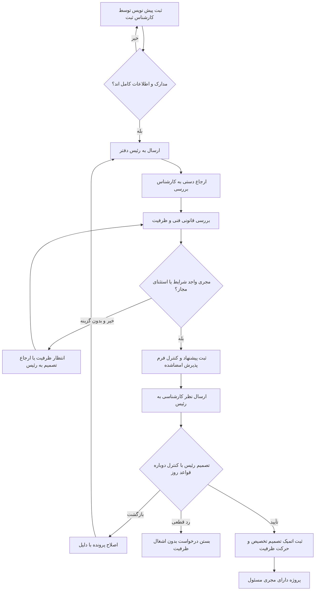
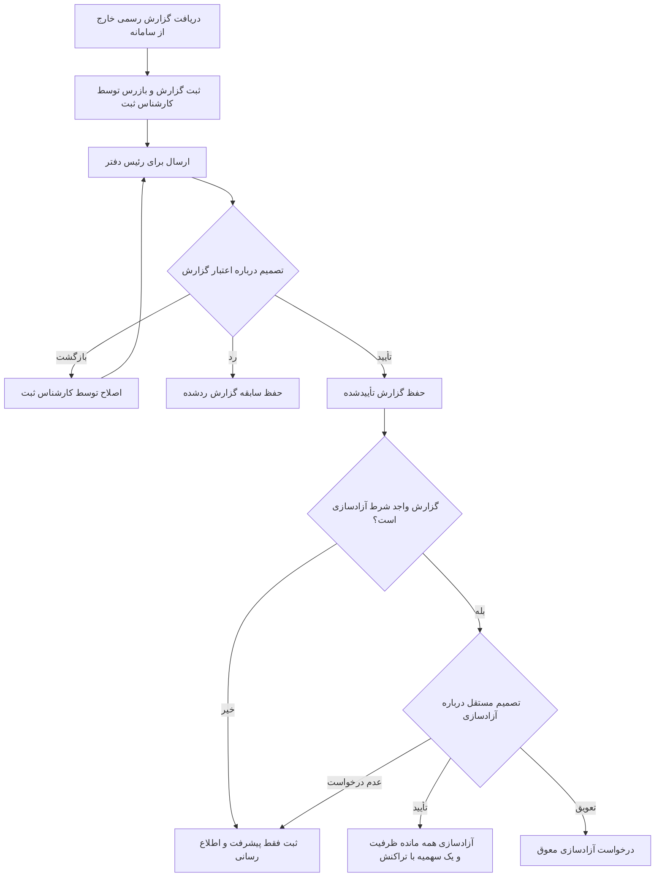
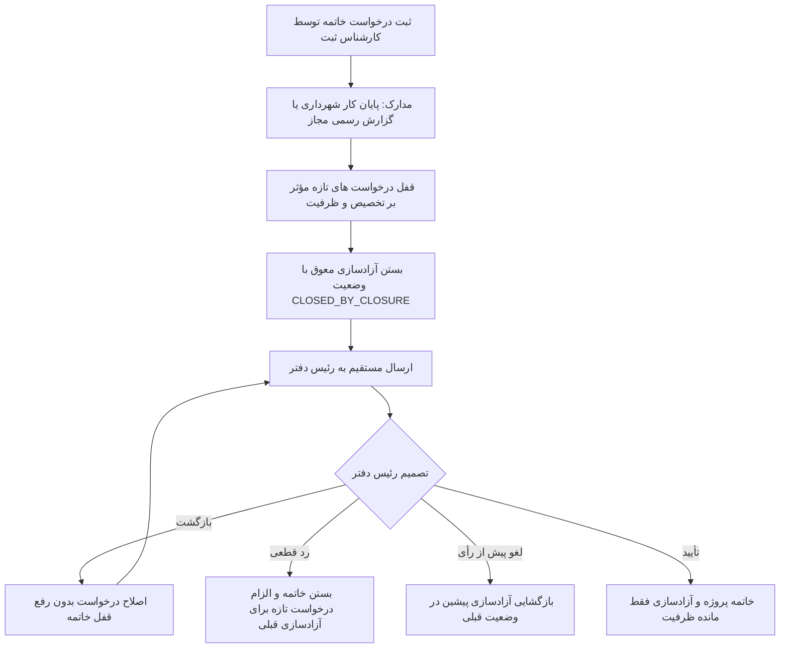
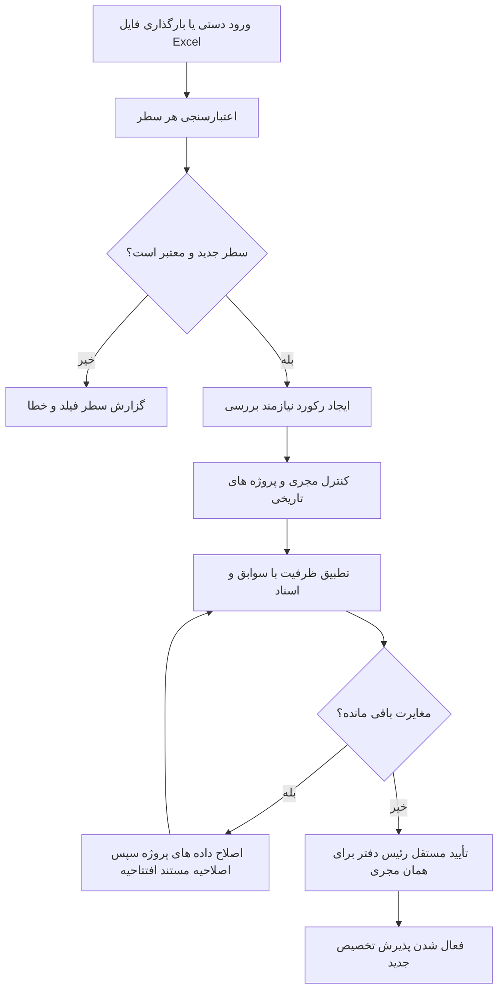

# جریان‌های کاربری، گردش کارها و منطق صفحات سامانه مدیریت ارجاع کار مجریان ذی‌صلاح ساختمان

**محل بهره‌برداری نسخه اول:** کارگروه مجریان ذی‌صلاح، دفتر نمایندگی سازمان نظام مهندسی ساختمان دزفول  
**نسخه سند:** `0.4-draft` | **تاریخ:** ۱۴۰۵/۰۸/۲۸ | **وضعیت:** برای بازبینی مالک محصول  
**وضعیت اسناد:** خروجی مستقل؛ هیچ‌یک از پنج سند اولیه تغییر نکرده‌اند.  
**نام فنی سند:** `User Flows & Wireframe Logic — Dezful MVP`  
**منابع تطبیق‌شده:** `User Flows & Wireframe Logic.md` (اصلی)، `Dezful_Executor_System_Decision_Register_v01.md`، `Business_Rules_Specification_Dezful_MVP_v04_Draft.md`، `Data_Dictionary_Entity_Schema_Dezful_MVP_v04_Draft.md` و `2- Problem_Understanding_Document_v2.docx`.

> **نحوه خواندن:** عبارت «قطعی» به معنی مصوب‌شدن نیازمندی در گفت‌وگوهای تحلیل است، نه احراز مطابقت آن با قوانین ایران. شناسه‌های `DEC-*`، `BR-*` و `ENT-*` به اسناد پروژه ارجاع می‌دهند، نه شماره مقررات. عناصر واسط کاربری و کدهای وضعیت که با «پیشنهادی» علامت خورده‌اند، هنوز طرح اجرایی هستند و الزام کسب‌وکار جدید محسوب نمی‌شوند.

## ۱. هدف و مرز سند

این سند مرحله چهارم تثبیت دامنه را پوشش می‌دهد: مسیرهای کاربری، گذار حالت‌ها، صفحات ضروری، کنترل‌های تعاملی، محدودیت دسترسی و معیارهای پذیرش **نسخه اول**. هدف ساخت یک سامانه داخلی با تعداد کم کاربر است؛ نه یک موتور عمومی توزیع کار، پورتال شهروندی یا سازنده بصری گردش کار. «میز کار بررسی» در سند قدیمی باید از یک صفحه تصمیم‌گیری یک‌مرحله‌ای به فرایند **ثبت‌کننده → رئیس دفتر → کارشناس بررسی → رئیس دفتر** تبدیل شود.

اصول ثابت:

1. **یک بهره‌بردار در دزفول**، بدون چندمستاجری یا چندشهری شدن نسخه اول؛ نام شهر در تنظیمات قابل نمایش است، اما ادعای استقرار عملیاتی در شهرهای دیگر نداریم. `DEC-S-01`
2. در شروع، یک نفر در هر جایگاه «ثبت درخواست مالکین»، «بررسی کارشناسی»، «رئیس دفتر» و «مدیر سیستم» در نظر گرفته شده است. تعداد رکورد کاربری محدود به یک نفر در پایگاه داده نیست. `DEC-S-02`
3. مجری، مالک، ناظر و بازرس **کاربر داخلی ندارند**؛ درخواست و گزارش آنان از مسیر مدارک/گزارش‌های بیرونی به‌دست کاربران داخلی ثبت می‌شود. `DEC-S-03`, `DEC-L-11`
4. تصمیم نهایی فقط با انتصاب معتبر رئیس دفتر یا جانشینی رسمیِ دارای اختیار ممکن است؛ `RBAC` به‌تنهایی این اختیار را نمی‌دهد. `DEC-S-05/07/08`
5. وضعیت اجرایی پروژه، **مسئولیت فعلی مجری** و **اشغال ظرفیت** سه مفهوم جدا هستند؛ ممکن است پروژه فعال و مجری مسئول باشد، اما ظرفیتش آزاد شده باشد. `DEC-L-09`, `DEC-Q-10`
6. مراحل اصلی گردش کار ثابت‌اند؛ برخی مسئولیت‌ها، شروط و اقلام مدارک با نسخه تنظیمات قابل پیکربندی‌اند؛ تغییر جدید گردش کار پرونده جاری را جابه‌جا نمی‌کند. قواعد صلاحیت و ظرفیت در تأیید نهایی با نسخه معتبر همان روز بازبینی می‌شوند. `DEC-U-05/06`, `DEC-R-14`
7. شکل ظاهری دو‌ستونی (`Split-Screen`) در فایل اولیه یک **الگوی پیشنهادی** است، نه قید کسب‌وکار. برای کاربر عملیاتی، اعتبارسنجی و کارتابل واضح مهم‌تر از الزام به چیدمان خاص است.

### ۱.۱. قرارداد واژگان

| اصطلاح فارسی | شناسه سامانه | تعریف و مرز |
|---|---|---|
| پروژه ساختمانی | `Construction_Project` | هویت و مشخصات پایدار پروژه؛ با تغییر مجری حذف یا دوباره ایجاد نشود |
| درخواست بررسی اولیه/جایگزین | `Review_Request` | درخواست ارجاع یک مجری؛ در هر پروژه حداکثر یک مورد **باز** از این نوع |
| ارزیابی کارشناسی | `Expert_Evaluation` | نتیجه کارشناسی و پیشنهاد؛ **تصمیم نهایی و کسر ظرفیت نیست** |
| تصمیم رسمی | `Formal_Decision` | تصمیم مستند رئیس دفتر/جانشین برای موضوع مشخص |
| تخصیص مجری | `Project_Allocation` | یک دوره مسئولیت مجری برای پروژه؛ تعویض مجری، تخصیص تازه است |
| گزارش پیشرفت | `Physical_Progress_Report` | گزارش رسمی خارجی ثبت‌شده به‌وسیله کارشناس ثبت و تأییدشده توسط رئیس دفتر |
| درخواست آزادسازی | `Capacity_Release_Request` | درخواست مستقل برای آزادسازی ظرفیت ناشی از پیشرفت |
| درخواست عملیاتی پروژه | `Project_Operation_Request` | اصلاح متراژ، خاتمه تخصیص، یا خاتمه عادی پروژه؛ هر کدام مسیر متفاوتی دارد |
| گردش ظرفیت | `Capacity_Movement` | رویداد مؤثر بر متراژ و سهمیه کارِ اشغال‌شده؛ به‌همراه رد حسابرسی |
| نسخه گردش کار | `Workflow_Config_Version` | تنظیمات ساختاری ثابت و شروط مجاز پرونده در زمان ایجاد آن |

## ۲. بازیگران، کارتابل‌ها و مسئولیت‌ها

| بازیگر | کارتابل اصلی | مجاز در نسخه اول | غیرمجاز بدون مجوز/سمت اضافی |
|---|---|---|---|
| کارشناس ثبت درخواست مالکین | پیش‌نویس‌ها، برگشتی‌ها، گزارش‌های پیشرفت، خاتمه عادی و فرم‌های مربوط | ثبت و کنترل مدارک، ایجاد/ارسال درخواست، اصلاح موارد برگشتی، ثبت گزارش خارجی، لغو درخواست مجاز با دلیل | تأیید نهایی تخصیص، آزادسازی، خاتمه، یا تأیید داده اولیه مجری |
| کارشناس بررسی‌کننده | درخواست‌های تخصیص و تغییرات عملیاتیِ ارجاع‌شده | بررسی واجدشرایط‌بودن، پیشنهاد مجری، مستندسازی نتیجه، بررسی فرم پذیرش امضاشده، ارسال نظر | تأیید قطعی/کسر ظرفیت، تغییر پرونده کارشناسی دیگر بدون ارجاع |
| رئیس دفتر | ارجاع، تصمیم نهایی، گزارش‌های پیشرفت، تغییر پروانه و اعضا، تأیید ظرفیت افتتاحیه | ارجاع/بازارجاع، بازگشت، تأیید/رد، کنترل استثنای مجاز، خاتمه، تأیید مدارک و ظرفیت اولیه | عدول از قواعدی که قانون/نسخه معتبر اجازه نداده است |
| جانشین رسمی رئیس دفتر | همان موارد رئیس در قلمرو و مدت ابلاغ | تصمیم مشترک در حدود ابلاغ معتبر؛ رئیس اصلی همچنان اختیار دارد | اقدام خارج از بازه/قلمرو ابلاغ؛ تأیید دوگانه یک موضوع |
| مدیر سیستم | تنظیمات، کاربران، قواعد و ممیزی، مشاهده سراسری | مدیریت حساب، نقش/مجوز، نسخه قواعد، نسخه تنظیمات، الگوی فرم، ثبت انتصاب/تفویض براساس حکم | تصمیم کسب‌وکار صرفاً به اعتبار دسترسی `Admin` |

**کنترل در لایه سرور الزامی است:** مخفی‌کردن دکمه به‌تنهایی مجوز ایجاد نمی‌کند. کارشناس بررسی فقط پرونده‌ای را می‌تواند *ارسال نهایی نظر کارشناسی* کند که `assigned_expert_user_id` آن در آن لحظه خودش باشد. هم‌زمانی اقدام رئیس/جانشین و چند نشست کاربری باید در تراکنش کنترل شود. `DEC-U-02/03/04`, `DEC-S-08`, `DEC-R-16`

**کاهش پیچیدگی:** با وجود مجوزهای چندنقشی، کارتابل مشترک، «برداشت پرونده»، توزیع خودکار و سناریوی چند کارشناس ثبت/بررسی طراحی عملیاتی نسخه اول نیست. اگر تنها کارشناس غیرفعال شود، تکلیف پرونده‌ها باید با رویه مدیریتیِ مشخص و قابل حسابرسی حل شود؛ رفتار پیشرفته توزیع خودکار در نسخه بعدی خواهد بود. این مورد در بخش «نیازمند تعیین تکلیف» آمده است.

## ۳. معماری اطلاعات و فهرست صفحات نسخه اول

### ۳.۱. منوی اصلی پیشنهادی

1. **داشبورد و کارتابل:** وظایف من، موارد منتظر رئیس، درخواست‌های برگشتی، هشدار مجری/پروانه و خلاصه ظرفیت.
2. **درخواست‌ها و ارجاع:** فهرست درخواست‌ها، ایجاد درخواست جدید، بررسی و تصمیم.
3. **پروژه‌ها:** پرونده پروژه، تخصیص‌ها، وضعیت پیشرفت، درخواست‌های عملیاتی، اسناد.
4. **مجریان:** پرونده مجری حقیقی/حقوقی، پروانه، اعضای امتیازآور، وضعیت و ظرفیت.
5. **ظرفیت و سوابق:** کارت ظرفیت، حرکات ظرفیت و ردیابی تصمیم/استثنا.
6. **ورود اطلاعات اولیه:** فرم دستی، ورود گروهی `Excel`، بررسی و تطبیق افتتاحیه.
7. **گزارش‌ها:** گزارش عملیاتی، داشبورد مدیریتی، فیلتر و خروجی `Excel`.
8. **مدیریت سامانه** (فقط با مجوز): کاربران و نقش‌ها، انتصاب و جانشینی، نسخه قواعد، تنظیمات گردش کار، قالب فرم و حسابرسی.

این‌ها **خوشه ناوبری** هستند؛ قرار نیست برای هر زیرموضوع یک ماژول مستقل یا میز کار پیچیده ساخته شود.

### ۳.۲. فهرست صفحات و رفتارهای کلیدی

| کد صفحه | عنوان / مسیر مفهومی پیشنهادی | نقش اصلی | داده‌ها و اقدام اصلی | خطا/وضعیت مهم |
|---|---|---|---|---|
| `UI-01` | ورود | همه کاربران داخلی | نام کاربری/رمز؛ ورود امن | حساب غیرفعال؛ پیام غیر افشاگرانه |
| `UI-02` | داشبورد و کارتابل | همه بر حسب مجوز | صف کارها، شمارنده وضعیت، اعلان‌ها و جست‌وجو | هیچ کار باز؛ اعلان خوانده‌شده |
| `UI-03` | فهرست درخواست‌ها | ثبت/بررسی/رئیس | نوع، وضعیت، پروژه، مجری، مسئول، تاریخ، فیلتر | دامنه مشاهده «خود/همه» |
| `UI-04` | ثبت/ویرایش درخواست اولیه یا جایگزین | ثبت | انتخاب/ثبت پروژه، مالک، نوع، روش انتخاب، چک‌لیست، ارسال | نقص مدارک، احتمال تکرار پروژه، درخواست باز دوم |
| `UI-05` | بررسی و پیشنهاد مجری | بررسی | مشخصات فنی، کنترل سه مرحله‌ای، جست‌وجوی مجریان، دلایل، فرم پذیرش | فاقد ظرفیت؛ عدم صلاحیت؛ تغییر نسخه قواعد |
| `UI-06` | تصمیم و ارجاع رئیس دفتر | رئیس/جانشین | تعیین کارشناس، مشاهده نتیجه، بررسی مجدد لحظه‌ای و تأیید/رد/بازگشت | رقابت هم‌زمان، استثنای غیرمجاز، فرم امضانشده |
| `UI-07` | پرونده مجری | ثبت/بررسی/رئیس | هویت، پروانه، عضویت شرکت، محدودیت، تاریخچه تخصیص | تغییر پروانه معوق؛ ظرفیت منفی |
| `UI-08` | کارت ظرفیت مجری | مجاز به مشاهده | سقف، اشغال، آزادِ متراژ و تعداد کار، گردش و مستندات | عدم فعال‌سازی افتتاحیه؛ منع تخصیص جدید |
| `UI-09` | پرونده پروژه | همه طبق مجوز | شناسه‌های ملک، تب تخصیص‌ها، گزارش پیشرفت، اسناد، تاریخچه | پروژه فعال با ظرفیت آزاد؛ انتظار مجری جایگزین |
| `UI-10` | ثبت گزارش پیشرفت | ثبت | مشخصات گزارش/بازرس خارجی، تاریخ، درصد، سند و ارسال | درصد پایین‌تر از مبنا؛ گزارش برگشتی |
| `UI-11` | تصمیم گزارش و آزادسازی | رئیس/جانشین | تأیید/بازگشت/رد گزارش؛ تأیید یا تعویق آزادسازی؛ تصمیم درخواست مستقل | آزادسازی تکراری، بسته‌شدن به‌سبب خاتمه |
| `UI-12` | درخواست تغییرات پروژه | ثبت، سپس بررسی/رئیس | اصلاح متراژ یا خاتمه تخصیص؛ مدارک و نظر کارشناسی | درخواست آزادسازی باز؛ اصلاح متراژ بعد از آزادسازی کامل |
| `UI-13` | درخواست خاتمه عادی پروژه | ثبت و رئیس | انتخاب مدرک خاتمه، کنترل، ارسال مستقیم به رئیس | منع تغییرات ظرفیت تا تعیین تکلیف |
| `UI-14` | نسخه‌های فرم پذیرش مسئولیت | ثبت/بررسی/مدیر قالب | انتخاب قالب/نسخه، ساخت PDF، ثبت تأیید امضا و اصلاح شکلی | PDF جدید بدون امضای مجدد معتبر نیست |
| `UI-15` | کنترل پروانه و عضو امتیازآور | ثبت/بررسی/رئیس | درخواست تغییر، کنترل اثر ظرفیت، رأی رئیس | تا تأیید، منع کار جدید برقرار |
| `UI-16` | ورود اولیه و تطبیق | مجوز ورود، کارشناس، رئیس | ورود دستی/Excel، ردیف خطا، تأیید مستقل هر مجری | داده تکراری، فقدان مدرک، مغایرت افتتاحیه |
| `UI-17` | گزارش‌ها | مجاز | فیلتر، شاخص‌ها، وضعیت کارتابل، خروجی Excel | کنترل دامنه دسترسی روی سرور/خروجی |
| `UI-18` | تنظیمات/حسابرسی | مدیر سیستم و سایر مجازها | کاربران، مجوزها، نسخه تنظیمات و قواعد، تفویض، وقایع | تعارض تاریخ اعتبار و اختیار سمت |

**اصل پیاده‌سازی سبک:** `UI-10` تا `UI-14` می‌توانند تب، زیرصفحه یا پنل در `UI-09` باشند؛ این فهرست الزام به ۱۸ مسیر مستقل `URL` نیست. در موبایل، فرم و خلاصه تصمیم می‌توانند روی هم قرار گیرند؛ پنل‌های ثابت دو‌ستونی ضروری نیستند.

### ۳.۳. الگوی ثابت نمایش جزئیات پرونده

سرصفحه هر پرونده اصلی پیشنهاد می‌شود شامل شناسه پرونده شهرداری، وضعیت پروژه، وضعیت درخواست، مسئول جاری، نسخه گردش کار، تاریخ آخرین اقدام و برچسب روشن «ظرفیت اشغال‌شده/آزادشده» باشد. زیر آن تب‌های «مشخصات»، «مدارک»، «بررسی و تصمیم»، «ظرفیت»، «تاریخچه» قرار گیرد. دو وضعیت **پروژه در حال اجرا** و **ظرفیت آزادشده** هرگز در رابط کاربری به‌صورت یک وضعیت ادغام نشوند.

## ۴. جریان اصلی: ایجاد، ارجاع، ارزیابی و تخصیص مجری

### ۴.۱. مسیر عادی تأیید اولیه — `FLOW-01`

**جزئیات اجرایی قطعی** (`DEC-R-01..16`, `BR-REQ-*`, `BR-CAP-*`):

1. کارشناس ثبت شماره پرونده شهرداری را وارد می‌کند. جست‌وجوی تکراری بر اساس شماره پرونده و نشانه‌های کمکی مانند کد نوسازی/پلاک انجام می‌شود. مغایرت احتمالی دو پروژه مستقل با ثبت دلیل و تأیید رئیس دفتر رفع می‌شود؛ سامانه نباید بی‌دلیل هر دو را یکی فرض کند.
2. مدارک کاغذی با ثبت «دریافت/راستی‌آزمایی»، تاریخ، مشخصات مرجع و محل بایگانی کنترل می‌شوند؛ بارگذاری تصویر اسکن عمومی اجباری نیست. پیش‌نویس ناقص به رئیس ارجاع نمی‌شود.
3. «ارسال» پیش‌نویس را قفل و آن را به رئیس دفتر می‌فرستد. رئیس، شخصِ کارشناس بررسی را تعیین می‌کند؛ در شروع بهره‌برداری معمولاً همان تنها کارشناس موجود است، ولی ارجاع همچنان رویداد رسمی دارد.
4. حالت `VALIDATION`: بررسی یک مجری معرفی‌شده توسط مالک. حالت `RECOMMENDATION`: نمایش مجریان واجد شرایط و ردشده همراه علت، بدون امتیازدهی/رتبه‌بندی خودکار. انتخاب کارشناس با دلیل ثبت می‌شود.
5. **قبل از ارسال نتیجه کارشناسی برای تأیید نهایی، فرم پذیرش مسئولیتِ امضاشده باید احراز شده باشد**؛ فایل PDF تولیدشده یا فرم بدون امضا کافی نیست.
6. رئیس دفتر می‌تواند مجری دیگری تعیین کند، ولی باید او را مجدداً ارزیابی کند. اگر نسخه قوانین از زمان نظر کارشناس تغییر کرده باشد، بازمحاسبه الزام‌آور است. هر عدول فقط درباره قاعده دارای مجوز استثنا و با مستند قابل اثبات مجاز است.
7. تا قبل از تأیید قطعی، هیچ ظرفیت یا سهمیه کاری رزرو/اشغال نمی‌شود. در لحظه تأیید قطعی، تصمیم، تخصیص، تصویر تصمیم و حرکت ظرفیت در **یک تراکنش** انجام می‌شوند.
8. رد قطعی، همین درخواست را می‌بندد؛ اقدام بعدی در صورت نیاز، درخواست تازه است. انصراف مالک پیش از تخصیص از مسیر ثبت و تأیید لغو انجام می‌شود؛ پس از تخصیص مسیر «خاتمه تخصیص» الزامی است.

**حالت بدون مجری واجد شرایط:** صف انتظار و تصمیم رئیس دفتر باقی می‌ماند؛ هیچ تخصیص خودکار، اولویت‌بندی خودکار و رزرو ظرفیت وجود ندارد. با آزادشدن ظرفیت، اعلان داخلی برای پرونده‌های منتظر مرتبط ایجاد می‌شود، اما تصمیم و بررسی مجدد انسانی باقی می‌ماند.

### ۴.۲. تغییر مسئول بررسی در پرونده باز — `FLOW-02`

- رئیس دفتر مسئول پرونده را عوض می‌کند؛ دلیل و زمان و مسئول قبلی/جدید در حسابرسی بماند.
- سوابق نظر/اقدام قبلی حذف نشود. مسئول جدید می‌تواند از سابقه قبلی استفاده کند، ولی ارسال **نظر نهایی** باید توسط خود او تأیید شود.
- تا زمانی که کارشناس جدید این نتیجه را تأیید نکرده، نظر قبلی را نباید به‌عنوان نظر نهایی کارشناس جاری تلقی کرد.
- کارتابل و اعلان فقط برای مسئول تازه و مجاز به‌روزرسانی شود. قابلیت مدیریت هم‌زمان چند کارشناس یا صف خودبرداشت در MVP لازم نیست.

### ۴.۳. جدول گذار درخواست بررسی (`Review_Request`) — پیشنهاد تکمیلی برای تأیید

وضعیت‌های زیر همان دامنه منطقی مدل داده `ENT-16` را پوشش می‌دهند؛ افزودن وضعیت کمکی یا نام‌گذاری `Enum` در زمان کدنویسی باید با همین منطق و قیود هماهنگ باشد.

| حالت فعلی | رویداد | بازیگر | حالت بعدی | اثر ظرفیت |
|---|---|---|---|---|
| `DRAFT` | ذخیره ناقص/تکمیل پیش‌نویس | ثبت | `DRAFT` | هیچ |
| `DRAFT` یا `RETURNED_FOR_CORRECTION` | ارسال پس از تکمیل | ثبت | `SUBMITTED_TO_HEAD` | هیچ |
| `SUBMITTED_TO_HEAD` | تعیین کارشناس | رئیس | `ASSIGNED_TO_EXPERT` | هیچ |
| `ASSIGNED_TO_EXPERT` | بررسی و ثبت نظر موقت | بررسی | بدون تغییر | هیچ |
| `ASSIGNED_TO_EXPERT` | اعلام نبود مجری و تعویق | بررسی/رئیس مطابق اختیار | `WAITING_CAPACITY` | هیچ |
| `WAITING_CAPACITY` | یافتن گزینه/برگشت به بررسی | رئیس و کارشناس | `ASSIGNED_TO_EXPERT` | هیچ |
| `ASSIGNED_TO_EXPERT` | کنترل فرم و ارسال نظر نهایی | بررسی مسئول فعلی | `EXPERT_SUBMITTED` | هیچ |
| `EXPERT_SUBMITTED` | تصمیم ارجاع برای اصلاح | رئیس | `RETURNED_FOR_CORRECTION` | هیچ |
| `EXPERT_SUBMITTED` | رد قطعی | رئیس | `REJECTED` | هیچ |
| `EXPERT_SUBMITTED` | تأیید نهایی با بررسی روز | رئیس/جانشین معتبر | `APPROVED` | اشغال اتمیک |
| قبل از تصمیم نهایی | پذیرش انصراف مالک | ثبت → تأیید رئیس | `CANCELLED` | هیچ |

**نکته بازگشت:** مقصد عملیاتی اصلاح مجری معرفی‌شده در حالت `VALIDATION`، کارشناس ثبت است؛ برای پیشنهاددهی `RECOMMENDATION` ممکن است بازگشت به کارشناس بررسی باشد. قاعده قطعی مشترک این است که *پس از ارسال مجدد درخواست بررسی اصلی، پرونده باید به رئیس دفتر برای ارجاع جدید بازگردد*. پیاده‌سازی می‌تواند نوع مقصد اصلاح را در فیلد جداگانه نگاه دارد، نه اینکه یک `Enum` را بیش از حد پیچیده کند.

**نکته مدل:** جدول فوق یک `Review_Request` برای تخصیص اولیه یا جایگزین را توصیف می‌کند. درخواست‌های مستقل آزادسازی، خاتمه و تغییر متراژ نباید به خاطر قید «یک درخواست بررسی باز» ممنوع شوند.

## ۵. جریان چرخه عمر پروژه و ظرفیت

### ۵.۱. ثبت و تأیید گزارش پیشرفت خارجی — `FLOW-03`

- گزارش شامل هویت/شناسه بازرس، تاریخ گزارش، تاریخ دریافت، شماره مرجع، درصد پیشرفت و محل نگهداری مستند است؛ بازرس در سامانه کارتابل ندارد.
- رئیس دفتر **همه** گزارش‌ها را بررسی می‌کند، حتی گزارش‌های پس از آزادسازی کامل ظرفیت؛ رد/بازگشت گزارش، وضعیت درخواست آزادسازی را بدون دلیل معادل آن نمی‌کند.
- اگر پیشرفت گزارش جدید از پیشرفت رسمی تأییدشده **کمتر** باشد، گزارش با سابقه و وضعیت اطلاع‌رسانی نگه داشته می‌شود؛ «پیشرفت مبنا» و ظرفیت آزادشده کاهش پیدا نمی‌کند. فرآیند اصلاح رسمی چنین خطایی به آینده موکول است.
- زمان‌بندی بازدید، مهلت ثبت و هشدار سررسید در MVP نیست.
- برای مجری جایگزین، تحقق آستانه ۸۰٪ بر **باقیمانده کار تحویل‌گرفته‌شده** محاسبه می‌شود. نمونه: تحویل در ۸۵٪ پیشرفت کل؛ تحقق ۸۰٪ کارِ باقی‌مانده معادل ۹۷٪ پیشرفت کل است.
- آستانه ۸۰٪ **پارامتر قابل تنظیم و مشروط به اعتبارسنجی حقوقی** است؛ تا پیش از احراز مقررات نباید در محیط عملیاتی به‌عنوان قاعده قانونی قطعی معرفی شود.

### ۵.۲. چرخه مستقل درخواست آزادسازی — `FLOW-04`

| وضعیت | مفهوم | اقدام‌های مجاز |
|---|---|---|
| `DRAFT` | درخواست آزادسازی ثبت اولیه شده است | تکمیل/ارسال/حذف مجاز در محدوده قواعد پیش‌نویس |
| `PENDING_HEAD` | منتظر تصمیم رئیس دفتر | تأیید / بازگشت / رد قطعی / لغو با دلیل توسط ثبت‌کننده قبل از رأی نهایی |
| `RETURNED` | برگشتی برای اصلاح | اصلاح و ارسال مجدد |
| `DEFERRED` | تصمیم آزادسازی به تعویق افتاده | بازبینی/تأیید یا رد یا بازگشت؛ بدون انقضای خودکار |
| `CLOSED_BY_CLOSURE` | با ثبت درخواست خاتمه عادی موقتاً بسته شده | ایجاد درخواست آزادسازی دوم ممنوع؛ نتیجه تابع خاتمه |
| `APPROVED` | آزادسازی یک‌باره قطعی | پایان؛ هر درخواست مجدد برای همان مانده بدون موضوع |
| `REJECTED` | رد قطعی درخواست آزادسازی | پایان؛ گزارش تأییدشده معتبر می‌ماند و درخواست تازه ممکن است |
| `CANCELLED` | لغو با دلیل پیش از تصمیم نهایی | پایان؛ گزارش تأییدشده معتبر می‌ماند |

**قواعد تداخل و نتیجه:**

- هر تخصیص در یک لحظه حداکثر **یک درخواست آزادسازی باز یا بسته‌شده به علت خاتمه** دارد؛ درخواست باز دوم ممنوع است. `DEC-L-16`
- تأیید گزارش پیشرفت تازه، مبنای همان درخواست **معوق** را به‌روزرسانی می‌کند؛ تاریخچه گزارش قبلی و نسخه قبلی درخواست حذف نمی‌شود. `DEC-L-15`
- سه زمان مستقل روی صفحه دیده می‌شوند: تاریخ گزارش بازرس، تاریخ ثبت/ارسال در سامانه، **زمان رأی رئیس دفتر**. فقط آخری زمان مؤثر آزادسازی است. `DEC-L-18`
- در صورت **ثبت درخواست خاتمه عادی**، آزادسازی بازِ مرتبط به `CLOSED_BY_CLOSURE` می‌رود؛ اگر خاتمه **لغو** شود، همان درخواست با وضعیت قبلی مؤثر بازمی‌گردد. اگر خاتمه **رد قطعی** شود، درخواست قدیمی بسته باقی می‌ماند و برای آزادسازی بعدی درخواست جدید لازم است. در تأیید خاتمه، مانده ظرفیت از مسیر خاتمه آزاد می‌شود، نه آزادسازی دوگانه. `DEC-L-19`
- اگر درخواست خاتمه برای اصلاح به ثبت‌کننده **برگردانده شود ولی لغو/رد قطعی نشده باشد**، خاتمه همچنان پرونده در جریان است؛ طبق قاعده قفل فعلی، تغییرات مؤثر بر ظرفیت و درخواست آزادسازی موازی به‌صورت خودکار از قفل خارج نمی‌شوند. این صورت‌بندی برای `UAT` باید با بهره‌بردار مرور شود.

### ۵.۳. خاتمه رسمی تخصیص و جانشینی مجری — `FLOW-05`

1. کارشناس ثبت درخواست خاتمه تخصیص را با مدارک لازم ثبت می‌کند. کارشناس بررسی ارزیابی و رئیس دفتر نتیجه را تأیید یا رد/برمی‌گرداند.
2. **تا تأیید رسمی خاتمه تخصیص**، مانده اشغال مجری قبلی و مسئولیتش تغییری نمی‌کند.
3. پس از تأیید، مسئولیت تخصیص قبلی خاتمه یافته و همه مانده متراژ و سهمیه هنوز اشغال‌شده **یک‌بار** آزاد می‌شوند؛ اگر پیش‌تر ظرفیت بر مبنای پیشرفت آزاد شده، آزادسازی مجدد صفر خواهد بود.
4. اگر پروژه هنوز خاتمه عادی نیافته، وضعیت «در انتظار تعیین مجری جایگزین» می‌گیرد و درخواست `Review_Request` از نوع `REPLACEMENT` با وضعیت `DRAFT` برای کارشناس ثبت ساخته می‌شود.
5. پیش از ارسال جایگزین، پیشرفت واقعی هنگام تحویل و تفاوت آن با سوابق قبلی با مدارک لازم ثبت/کنترل می‌شود. مجری جدید با مشخصات فنی **کل پروژه** سنجیده می‌شود، ولی فقط متراژ باقی‌مانده از زمان تحویل ظرفیتش را اشغال می‌کند.
6. فرم پذیرش مسئولیت جدید و امضای مستقل مجری جایگزین الزامی است. پس از رأی رئیس دفتر، تخصیص دوم ثبت و کارتابل/گزارش‌ها روزآمد می‌شود.

**مدل جایگزینی:** `Project_Allocation` قبلی حفظ می‌شود؛ تاریخچه مجریان بر روی همان `Construction_Project` باقی می‌ماند. پروژه جدید برای جایگزینی ساخته نشود. در عین حال، خاتمه مسئولیت قبلی را با پایان ساختمان یکی نکنیم.

### ۵.۴. اصلاح متراژ پروژه — `FLOW-06`

- تغییر واقعی متراژ (کاهش یا افزایش) **فقط پیش از آزادسازی کامل ظرفیت** ممکن است؛ نیازمند مدارک، ارزیابی و تأیید رئیس است. این تصمیم با «اصلاح ظاهری متن PDF» متفاوت است.
- اگر درخواست آزادسازی باز باشد، تغییر متراژ قابل ثبت و بررسی است، ولی **تأیید نهایی** تا تعیین تکلیف درخواست آزادسازی معلق می‌شود. سپس ظرفیت و قواعد روز تصمیم دوباره ارزیابی می‌شوند.
- اگر در فاصله بررسی، آزادسازی کامل تأیید شود، درخواست اصلاح به `SUSPENDED_FULL_RELEASE` منتقل می‌شود و **رئیس دفتر باید رد قطعی آن را ثبت کند**؛ نباید سامانه بی‌صدا آن را تأیید یا حذف کند.
- فرمول دقیق اثر اصلاح متراژ روی مانده اشغال، با توجه به تخصیص جایگزین و پیشرفت، در اسناد فعلی به‌عنوان مسئله باز `OPEN-DATA` آمده است؛ پیش از کدنویسی منطق مالی/ظرفیتی آن باید جداگانه تأیید شود. **تا حل این ابهام مقدار تغییر ظرفیت را حدس نمی‌زنیم**.

### ۵.۵. خاتمه عادی پروژه — `FLOW-07`

- درخواست خاتمه عادی **مستقیم** به رئیس دفتر می‌رود؛ ارجاع به کارشناس بررسی برای این نوع درخواست در MVP وجود ندارد.
- پیش از تصمیم نهایی، کارشناس ثبت می‌تواند با **دلیل** درخواست خاتمه را لغو کند؛ با لغو، آزادسازی معوق قبلی باز می‌شود.
- رد قطعی خاتمه، گزارش پیشرفت و تخصیص جاری را به خودی خود باطل نمی‌کند؛ برای آزادسازی جدید باید درخواست تازه آغاز شود.
- با تأیید، پروژه مختومه و فقط مانده واقعی ظرفیت اشغال‌شده آزاد می‌شود؛ اگر ظرفیت قبلاً آزاد شده باشد، حرکت آزادسازی مجدد نباید آن را منفی کند. زمان مؤثر رأی رئیس است.
- ابطال/بازگشایی خاتمه قطعی پس از رأی تأیید در نسخه اول پیاده‌سازی نمی‌شود.

### ۵.۶. ماتریس تعارض عملیات هم‌زمان (الزام سمت سرور)

| وضعیت فعلی | عملیات تازه | در MVP | واکنش پیشنهادی رابط کاربری و سرور |
|---|---|---|---|
| درخواست بررسی باز برای پروژه | درخواست بررسی اصلی دوم | ممنوع | خطا و لینک همان درخواست باز |
| درخواست آزادسازی باز برای تخصیص | درخواست آزادسازی دوم | ممنوع | نمایش همان درخواست باز؛ عدم ایجاد تکراری |
| درخواست آزادسازی باز | اصلاح متراژ/خاتمه تخصیص | ثبت و کارشناسی مجاز، **تأیید نهایی معلق** | نمایش دلیل تعلیق در کارتابل رئیس |
| اصلاح متراژ منتظر تصمیم | آزادسازی کامل ظرفیت | مجاز؛ اصلاح متراژ معلق/سپس رد قطعی رئیس | نشان‌دادن `SUSPENDED_FULL_RELEASE` و نیاز به رأی رد |
| خاتمه عادی در جریان | ایجاد تغییر مجری، متراژ یا درخواست اثرگذار جدید | ممنوع | اقدام غیرفعال و پاسخ معتبر سرور |
| خاتمه عادی در جریان | ثبت گزارش صرفاً اطلاعاتی | مجاز | بدون تغییر ظرفیت و با تاریخچه |
| خاتمه عادی تازه ایجاد شده | آزادسازی معوق موجود | بسته‌شدن موقت | `CLOSED_BY_CLOSURE` تا تعیین تکلیف خاتمه |
| آزادسازی پیش‌تر کامل | آزادسازی مجدد همان تخصیص | بدون اثر و بدون حرکت تکراری | پیام «ظرفیت این تخصیص قبلاً آزاد شده است» |
| پروانه/عضو امتیازآور/افتتاحیه مؤثر در وضعیت انتظار | تخصیص جدید به مجری | ممنوع | توضیح مانع و درخواست مرتبط |
| پرونده جاری با نسخه قبلی گردش کار | تغییر تنظیمات گردش کار توسط مدیر | تغییر پرونده جاری ممنوع | حفظ نسخه قبلی برای آن پرونده |
| پرونده کارشناسی باز با مسئول تغییرکرده | ارسال نظر توسط مسئول قبلی | ممنوع | خطای دسترسی؛ نیاز به تأیید کارشناس جدید |
| دو تصمیم‌گیرنده معتبر هم‌زمان | تأیید نهایی یک درخواست | فقط یک موفق | پیام تغییر وضعیت به نشست دوم |

## ۶. فرم رسمی پذیرش مسئولیت مجری — `FLOW-08`

| مرحله | اقدام و صفحه | کنترل الزام‌آور |
|---|---|---|
| ۱. انتخاب روش | فرم رسمی خارج سامانه یا ساخت فرم از قالب `DOCX` جاری | هر دو روش معتبر باشند |
| ۲. ساخت یا ثبت | تولید PDF با داده پروژه/مجری و نگهداری نسخه یا ثبت مرجع فرم بیرونی | PDF چاپی به معنی تأیید امضا نیست |
| ۳. تأیید پذیرش | کارشناس بررسی صحت فرم امضاشده را بر اساس سند فیزیکی کنترل کند | `SIGNED_VERIFIED` پیش از ارسال پرونده برای رأی تخصیص ضروری است |
| ۴. اصلاح **قبل از امضا** | بازتولید PDF بدون تأیید امضا | نسخه قبلی حسب قواعد تاریخچه نگه داشته شود |
| ۵. اصلاح **پس از امضا** | نسخه جدید PDF با دلیل، سپس اخذ امضای مجدد | امضای نسخه قبلی به PDF جدید منتقل نشود |
| ۶. اصلاح شکلی **پس از تخصیص** | کارشناس بدون تصمیم مجدد رئیس، فقط در صورت عدم تغییر داده ماهوی | دلیل/نسخه/تأیید امضای جدید حسابرسی شود |
| ۷. تغییر ماهوی | ارجاع به گردش اصلاح واقعی اطلاعات/تخصیص | از مسیر «ویرایش PDF» قابل دورزدن نیست |

**مرز باز:** نحوه نگهداری اصل فایل/تصویر فرم امضاشده قبلی در فرایند جایگزینی نسخه، در سند مدل داده به‌عنوان ریسک اثباتی باقی مانده است. نسخه/مرجع/رویداد اصلاح باید قطعاً قابل ردیابی باشد؛ سیاست حفظ بایت فایل قدیمی به تأیید رسمی نیاز دارد.

## ۷. مجریان، پروانه، اعضای امتیازآور و افتتاحیه

### ۷.۱. تغییر پروانه — `FLOW-09`

1. کارشناس تغییر را ثبت و همراه مستند برای رئیس دفتر می‌فرستد؛ **از لحظه ثبت تغییرِ در انتظار بررسی** تخصیص جدید به مجری ممنوع می‌شود.
2. رئیس اطلاعات جدید را تأیید/بازمی‌گرداند/رد می‌کند؛ در رد نیز منع تخصیص جدید **باقی می‌ماند** تا اطلاعات اصلاحی ثبت و تأیید شوند.
3. در تأیید، پایه، سقف و صلاحیت روزآمد و ظرفیت آزاد دوباره محاسبه می‌شوند (امکان منفی‌شدن ظرفیت آزاد بدون ابطال تخصیص‌های قطعی قبلی).
4. انقضای خود پروانه، دریافت کار تازه را منع می‌کند و پروژه‌های فعال را علامت‌گذاری می‌کند؛ ظرفیت قبلی خودکار آزاد نمی‌شود. با تأیید پروانه معتبر، محدودیت صرفاً ناشی از انقضا برداشته می‌شود.

### ۷.۲. تغییر عضو امتیازآور — `FLOW-10`

- ثبت درخواست ورود، خروج یا اصلاح عضو امتیازآور شرکت و ارسال برای رئیس دفتر؛ تا تعیین تکلیف تغییر مؤثر، تخصیص تازه به شرکت مسدود است.
- فرد هم‌زمان در دو شرکت امتیازآور نباشد. پیش از ورود به امتیازآوری شرکت، پروژه فردی فعالِ مانع باید تعیین تکلیف شده باشد.
- خروج تأییدشده از شرکت، سقف شرکت را فوراً بازحساب می‌کند؛ تخصیص‌های موجود شرکت حذف نمی‌شوند. فرد از منع ناشی از امتیازآوری برای دریافت کار شخصی خارج می‌شود، مشروط به سایر شروط صلاحیت و ظرفیت.

### ۷.۳. ورود اولیه اطلاعات و فعال‌سازی مجری — `FLOW-11`

- ورود گروهی `Excel` فقط **ایجاد رکورد جدید** انجام می‌دهد؛ ردیف تکراری یا ناسالم رد، ردیف درست وارد و در وضعیت «نیازمند بررسی انسانی» باقی می‌ماند. تأیید یک مجری منتظر تأیید همه فایل/مجریان نیست.
- برای پروژه تاریخی **بدون مدرک معتبر آزادسازی**، کل متراژ و یک سهمیه کار اشغال تلقی شود. در وجود اسناد معتبر، وضعیت اشغال/آزاد هر پروژه تاریخی توسط رئیس تأیید می‌شود.
- اختلاف با عدد رسمی ابتدا با اصلاح سوابق پروژه‌ها بررسی می‌شود؛ باقیمانده اختلاف با اصلاحیه افتتاحیه مستند و مستقل و رأی رئیس حل می‌شود.
- پس از فعال‌سازی، اصلاح افتتاحیه مؤثر بر ظرفیت تا تأیید رئیس، تخصیص تازه را متوقف می‌کند؛ با تأیید بازمحاسبه انجام می‌شود.
- صفحه «نتایج ورود» باید تعداد ردیف‌های پذیرش/رد، شماره سطر، فیلد خطادار و دلیل را نمایش دهد و خروجی قابل استفاده برای اصلاح فایل فراهم کند.

## ۸. تنظیمات، کارتابل، ممیزی و گزارش‌ها

### ۸.۱. مدیریت کاربران و انتصاب رئیس دفتر — `FLOW-12`

- مدیر سیستم حساب داخلی را ایجاد/فعال/غیرفعال می‌کند، رمز را بازنشانی می‌کند و نقش‌های دلخواه با مجوزهای از پیش شناخته‌شده سامانه تنظیم می‌کند؛ اجتماع مجوزهای چند نقش اعمال می‌شود.
- تغییر متصدی رئیس دفتر، پرونده‌های منتظر تصمیم را از طریق **انتساب سمت سازمانی** به متصدی جدید قابل دسترس می‌کند؛ نیاز به بازنویسی مالک هر پرونده نیست.
- تفویض جانشین بر مبنای **ابلاغ رسمی** توسط مدیر ثبت می‌شود: صادرکننده، فرد، تاریخ شروع/پایان و حدود اختیارات. حداکثر یک جانشین فعال در MVP؛ رئیس دفتر نیز هم‌زمان اختیار خود را حفظ می‌کند.
- جانشین فقط وظایف در محدوده تفویض معتبر را می‌بیند؛ درخواست اولین تصمیم موفق در تراکنش بسته می‌شود. مدیر سیستم بدون تصدی سمت/تفویض معتبر نمی‌تواند از راه اعطای مجوز `decision.finalize` تصمیم نهایی بگیرد.
- **سناریوی قطع همکاری تنها کارشناس ثبت/بررسی:** چون فرض MVP تنها یک نفر در هر نقش است و صف مشترک حذف شده، رویه انتقال دستی مسئولیت و استفاده از حساب جایگزین باید پیش از بهره‌برداری تعریف شود؛ تولید صف توزیع پیشرفته خودکار خارج از MVP است.

### ۸.۲. تنظیم نسخه ضوابط و گردش کار — `FLOW-13`

| تغییر | رفتار سامانه |
|---|---|
| ویرایش/فعال‌سازی ضابطه ظرفیت | ایجاد نسخه و بازه اعتبار جدید، ثبت دلیل/مستند/کاربر؛ تصمیمات قبلی تغییر نکنند؛ تأیید نهایی طبق نسخه معتبر لحظه رأی باشد |
| تغییر چک‌لیست مدارک | نسخه جدید برای درخواست‌های **بعدی**؛ چک‌لیست پرونده باز حفظ شود |
| تغییر نقش مسئول در گردش کار | صرفاً در حدود مجوزهای معتبر و جایگاه سازمانی؛ تغییر مراحل اصلی ممکن نباشد؛ روی پرونده باز قبلی اثر نکند |
| بارگذاری قالب `DOCX` جدید | نسخه جدید برای ساخت فرم‌های بعدی؛ فرم‌های پیشین تاریخچه خود را نگه دارند |
| تعریف تغییر مسیر دلخواه/افزودن مرحله از پنل | **خارج از دامنه MVP**؛ تنها از راه توسعه نسخه بعدی |

**مرز مهم:** هیچ تنظیمی اجازه نمی‌دهد مدیر سیستم قواعد لازم‌الاجرا را بدون پشتوانه حقوقی نادیده بگیرد؛ امکان فنی نسخه‌بندی به معنی اختیار قانونیِ صدور ضابطه نیست.

### ۸.۳. داشبوردها و گزارش‌ها — `FLOW-14`

**عملیاتی:** درخواست‌ها به تفکیک وضعیت/مسئول/نوع، مدت توقف در گام‌ها، پرونده‌های برگشتی، مجریان دارای ظرفیت/بدون ظرفیت، مانده متراژ و تعداد کار، فعالیت‌های مؤثر بر ظرفیت، گزارش‌های پیشرفت ثبت‌شده، پرونده‌های منتظر تأیید و محدودیت‌های پروانه.

**مدیریتی:** تعداد تأیید/رد در بازه، حجم کار رسیدگی‌شده، آمار تخصیص حقیقی/حقوقی، میزان اشغال ظرفیت، پروژه‌های در حال اجرا/مختومه/در انتظار مجری و مدت چرخه تصویب. نمایش داده باید با آخرین وضعیت معتبر و قابلیت رجوع به تاریخچه باشد.

**الزامات:** فیلتر و خروجی `Excel`؛ همان قید `RBAC` که روی فهرست صفحه است باید در درخواست خروجی نیز در سمت سرور اعمال شود. در MVP گزارش‌ساز پویا، سیستم ارسال دوره‌ای و یادآور موعد گزارش بازرس وجود ندارد.

### ۸.۴. الگوی بازخورد و خطا — `UX-STD`

| موقعیت | رفتار پیشنهادی |
|---|---|
| ثبت موفق پیش‌نویس | پیام کوتاه + وضعیت «پیش‌نویس»؛ بدون تغییر ظرفیت |
| نقص مدارک در ارسال | پیام نزدیک چک‌لیست معیوب، تمرکز روی اولین خطا؛ اجازه ذخیره پیش‌نویس |
| رقابت دو کاربر بر سر نسخه داده | خطای `409 Conflict` یا معادل؛ نمایش «اطلاعات تغییر کرده، بازخوانی کنید»؛ عدم بازنویسی |
| رقابت دو تصمیم نهایی | فقط یکی اعمال؛ کاربر دوم وضعیت تازه را می‌بیند؛ بدون اثر ظرفیت مضاعف |
| کاهش ظرفیت بر اساس قاعده جدید | نمایش علت، نسخه قاعده و گزینه ارجاع به رئیس در محدوده استثنای مجاز |
| تأیید در حضور فرم بدون امضا | بلوکه‌کردن ارسال نتیجه برای تصمیم قطعی؛ نمایش وضعیت امضا |
| آزادسازی ظرفیت قبلاً انجام شده | پیام «مانده اشغال این تخصیص صفر است»؛ عدم حرکت تکراری |
| تعارض فرایند خاتمه و تغییر متراژ | پیام ارجاع به خاتمه در جریان، عدم اجازه ایجاد درخواست تازه |
| اصلاح PDF امضاشده | درخواست دلیل، ساخت نسخه تازه و علامت «نیازمند امضای مجدد» |
| مشاهده ظرفیت منفی | نمایش عدد منفی و علت/مرجع تصمیم، نه مخفی‌سازی و تبدیل نمایشی به صفر |

## ۹. ماتریس حداقل مجوزها (`RBAC`) و اقدام‌ها

در جدول، **✓** یعنی در الگوی نقش پیشنهادی نسخه اول مجاز، **س** یعنی صرفاً مشاهده مشروط به دسترسی خود/همه، و «سمت» یعنی علاوه بر مجوز، انتصاب معتبر لازم است. این الگو **از پیش‌فرض‌ها** است؛ مدیر سیستم می‌تواند مجوزهای عملیاتی شناخته‌شده را طبق سیاست تفویض کند، ولی حق تصمیم اختصاصی سمت را ایجاد نمی‌کند.

| اقدام | ثبت | بررسی | رئیس دفتر | جانشین | مدیر سیستم |
|---|:---:|:---:|:---:|:---:|:---:|
| ثبت/ارسال درخواست اولیه | ✓ | — | س | س | س |
| بررسی و ارسال نظر تخصیص | س | ✓ برای پرونده محول | س | س | س |
| ارجاع/بازارجاع کارشناس بررسی | — | — | ✓ | طبق سمت | — |
| تصمیم قطعی تخصیص، آزادسازی، خاتمه | — | — | سمت | سمت و دامنه | — |
| ثبت گزارش پیشرفت خارجی | ✓ | س | س | س | س |
| تأیید گزارش پیشرفت | — | — | سمت | سمت و دامنه | — |
| ساخت/اصلاح نسخه فرم پذیرش | س | ✓ در پرونده مرتبط | س | س | مدیریت قالب فقط |
| ثبت تغییر پروانه/عضو امتیازآور | طبق مجوز | طبق مجوز | س | س | س |
| تصویب پروانه/عضو امتیازآور | — | — | سمت | سمت و دامنه | — |
| ورود گروهی Excel | طبق مجوز `import.create` | طبق مجوز | طبق مجوز | طبق مجوز | تنها اگر مجوز جداگانه داشته باشد |
| تأیید ظرفیت افتتاحیه | — | — | سمت | سمت و دامنه | — |
| مدیریت نسخه قواعد/تنظیمات | — | — | مشاهده | مشاهده | ✓ |
| مدیریت کاربران/نقش‌ها و جانشینی | — | — | مشاهده | مشاهده | ✓ بر اساس حکم |
| مشاهده پرونده/گزارش/حسابرسی | براساس `RBAC` | براساس `RBAC` | براساس `RBAC` | براساس محدوده/مجوز | همه پرونده‌ها و ممیزی |

**ملاحظه:** ستون «مدیر سیستم» برای مشاهده همه، به معنی حق تغییر مستقل اطلاعات اجرایی نیست. اعمال مجوز عملیاتی اضافی به همان شخص می‌تواند امکانات غیرانحصاریِ سمت بدهد، اما سمت رئیس دفتر را ایجاد نمی‌کند.

## ۱۰. سناریوهای پذیرش قابل اجرا (`UAT`)

| شناسه | مسیر آزمون | انتظار قطعی | رد تصمیم/قاعده |
|---|---|---|---|
| `UF-AT-01` | ثبت درخواست ناقص و تلاش ارسال | فقط پیش‌نویس ذخیره، ارجاع ناممکن | `DEC-R-01/02` |
| `UF-AT-02` | ثبت پروژه با شماره شهرداری تکراری/نشانه ثبتی مشابه | عدم ایجاد تکراری بدون بررسی و مسیر دلیل/تأیید رئیس | `DEC-R-03` |
| `UF-AT-03` | ارسال و ارجاع دستی به بررسی | کارتابل مسئول، ثبت تاریخچه ارجاع، ظرفیت بدون تغییر | `DEC-R-05/06` |
| `UF-AT-04` | فرم پذیرش بدون امضا | ارسال نتیجه برای تخصیص نهایی مسدود | `DEC-R-13`, `DEC-F-01` |
| `UF-AT-05` | تغییر قواعد پس از ارسال نظر کارشناسی | تأیید نهایی فقط پس از ارزیابی طبق قواعد معتبر روز | `DEC-R-14` |
| `UF-AT-06` | دو تأیید رقابتی با یک سهمیه باقیمانده | بدون استثنای مجاز فقط یکی موفق، بدون رزرو یا دوبارکسر | `DEC-Q-09/13` |
| `UF-AT-07` | هیچ مجری واجد شرایط نیست | انتظار/اعلان تغییر ظرفیت، بدون رزرو یا رد خودکار | `DEC-R-09` |
| `UF-AT-08` | بازارجاع پس از نظر کارشناس قبلی | فقط تأیید شخصی کارشناس جدید قابل ارسال؛ تاریخچه محفوظ | `DEC-R-16` |
| `UF-AT-09` | گزارش تأییدشده زیر ۸۰٪ | صرفاً گزارش معتبر؛ ظرفیت بدون تغییر | `DEC-L-08/10` |
| `UF-AT-10` | گزارش ۸۵٪ و تأیید صریح آزادسازی | همه مانده متراژ و یک سهمیه آزاد، پروژه و مسئولیت جاری باقی | `DEC-L-08/09` |
| `UF-AT-11` | دوباره زدن دکمه تأیید آزادسازی | دومین عملیات بی‌اثر؛ رویداد ظرفیت تکراری ندارد | `DEC-L-08`, `DEC-Q-12` |
| `UF-AT-12` | گزارش ۷۵٪ بعد از گزارش رسمی ۸۵٪ | فقط اطلاع‌رسانی؛ مبنای پیشرفت و ظرفیت پایین نمی‌آید | `DEC-L-12` |
| `UF-AT-13` | گزارش ۹۵٪ پس از درخواست آزادسازی معوق | همان درخواست بر مبنای گزارش جدید به‌روزرسانی، تاریخچه حفظ | `DEC-L-15` |
| `UF-AT-14` | ایجاد خاتمه در حضور آزادسازی معوق، سپس لغو خاتمه | `CLOSED_BY_CLOSURE` و پس از لغو بازگشایی همان درخواست | `DEC-L-19` |
| `UF-AT-15` | رد قطعی خاتمه پس از بستن آزادسازی معوق | آزادسازی قبلی خودکار باز نشود؛ درخواست تازه لازم | `DEC-L-19` |
| `UF-AT-16` | خاتمه عادی بدون گردش کارشناسی | کارشناس ثبت → رئیس دفتر → آزادسازی مانده/مختومه | `DEC-L-20/21/22` |
| `UF-AT-17` | خاتمه تخصیص قبل از پایان پروژه | ظرفیت قبلی پس از تأیید آزاد، پروژه در انتظار جایگزین، درخواست پیش‌نویس جدید | `DEC-L-02/07` |
| `UF-AT-18` | جانشینی در پیشرفت ۸۵٪ | اشغال ۱۵٪ پروژه برای جدید و آستانه ۹۷٪ کل برای ۸۰٪ باقیمانده | `DEC-L-03/04` |
| `UF-AT-19` | تغییر متراژ و آزادسازی باز | بررسی مجاز، رأی نهایی تغییر مسدود تا بسته‌شدن آزادسازی | `DEC-L-24` |
| `UF-AT-20` | تغییر متراژ باز و آزادسازی کامل | وضعیت توقف و سپس رد قطعی صریح رئیس | `DEC-L-05/06` |
| `UF-AT-21` | درخواست اصلاح پروانه و رد آن | تا تأیید داده اصلاحی، منع تخصیص جدید ادامه | `DEC-Q-07` |
| `UF-AT-22` | ورود Excel با سطر سالم، تکراری و خطادار | پذیرش جزئی، گزارش سطر/فیلد، داده صحیح منتظر تأیید | `DEC-I-03/04/05` |
| `UF-AT-23` | پروژۀ تاریخی بدون سند آزادسازی | تمام متراژ و یک سهمیه بلوکه در افتتاحیه | `DEC-I-06/07` |
| `UF-AT-24` | جانشین در/خارج از مدت یا قلمرو ابلاغ | فقط در محدوده معتبر تصمیم؛ رئیس همچنان دسترسی دارد | `DEC-S-07/08` |
| `UF-AT-25` | تغییر نسخه گردش کار در حین رسیدگی | پرونده جاری با نسخه پیشین؛ درخواست تازه نسخه جدید | `DEC-U-05` |
| `UF-AT-26` | اصلاح شکلی PDF امضاشده پس از تخصیص | نسخه تازه و الزام امضای دوباره؛ بدون رأی مجدد رئیس، در صورت ماهوی‌نبودن | `DEC-F-04/05` |
| `UF-AT-27` | ویرایش هم‌زمان یک فرم با دو نشست | ذخیره دوم با نسخه قدیمی رد و اطلاعات جدید محفوظ | `DEC-Q-13` |
| `UF-AT-28` | خروجی Excel گزارش با دسترسی «خود» | عدم افشای پرونده‌های خارج از دامنه مجوز | `DEC-U-04/07` |
| `UF-AT-29` | مدیر سیستم بدون سمت تلاش تأیید قطعی | منع در UI و API؛ ثبت تلاش نامجاز در لاگ امنیتی | `DEC-U-03` |
| `UF-AT-30` | مجری فعال با ظرفیت آزاد منفی پس از اصلاح سقف | عدد منفی نمایش، تخصیص قبلی برقرار، کار تازه مسدود مگر استثنای معتبر | `DEC-Q-04/10` |

## ۱۱. نقشه ردیابی گردش‌کار به مدل داده و قواعد

| مسیر | موجودیت‌های اصلی | تصمیم و قاعده اصلی |
|---|---|---|
| `FLOW-01/02` درخواست و کارشناسی | `ENT-07`, `ENT-16`, `ENT-17`, `ENT-18`, `ENT-09`, `ENT-25` | `DEC-R-*`, `BR-REQ-*`, `BR-AUD-01/03` |
| `FLOW-03/04` گزارش و آزادسازی | `ENT-20`, `ENT-21`, `ENT-18`, `ENT-19` | `DEC-L-08..19`, `BR-LFC-06..11` |
| `FLOW-05/06` جایگزینی و تغییر متراژ | `ENT-08`, `ENT-22`, `ENT-16`, `ENT-19` | `DEC-L-02..07`, `BR-LFC-13/14/18` |
| `FLOW-07` خاتمه عادی | `ENT-22`, `ENT-18`, `ENT-19` | `DEC-L-19..23`, `BR-LFC-11/12` |
| `FLOW-08` فرم پذیرش | `ENT-23`, `ENT-25`, `ENT-26` | `DEC-F-*`, `BR-DOC-*` |
| `FLOW-09/10` پروانه و امتیازآوری | `ENT-02/03`, `ENT-28/29`, `ENT-18`, `ENT-19` | `DEC-Q-04..08`, `BR-ELG-*` |
| `FLOW-11` افتتاحیه | `ENT-30/31/32`, `ENT-19`, `ENT-18` | `DEC-I-*`, `BR-IMP-*` |
| `FLOW-12/13` مدیریت | `ENT-27`, `ENT-33/34/35`, `ENT-36` | `DEC-U-*`, `DEC-S-05..08`, `BR-ADM-*` |
| `FLOW-14` گزارش | `ENT-07/08/16/19/20/36` | `DEC-U-04/07`, `BR-ADM-07` |

## ۱۲. موارد باز و مرزبندی طراحی

موارد زیر **نیازمندی جدیدِ مصوب نیستند** و باید پیش از پیاده‌سازی بخش مربوط با نمونه واقعی یا تصمیم مالک محصول تعیین تکلیف شوند:

| کد | مسئله | اثر | پیشنهاد محدود و غیرقطعی |
|---|---|---|---|
| `OPEN-UF-01` | استناد حقوقی آستانه پیشرفت ۸۰٪، حدود ظرفیت و اختیار استثنا/جانشین | مانع راه‌اندازی قواعد قانونی | مصوبه و مرجع اختیار قابل استناد پیش از `UAT` موتور قواعد دریافت شود |
| `OPEN-UF-02` | نمونه فرم واقعی پذیرش، مدارک شهرداری/بازرس و فایل ورودی Excel | مانع نهایی‌کردن اعتبارسنجی فیلدها و فرم | نمونه بدون داده شخصی یا با داده پوشیده برای تطبیق تهیه شود |
| `OPEN-UF-03` | فرمول اثر اصلاح متراژ در حالت‌های پیشرفت/جایگزینی متعدد | مانع کدنویسی آن گردش ظرفیت | نمونه عددی مصوب و سناریوهای منفی/مثبت تهیه شود |
| `OPEN-UF-04` | رویه روز غیرفعال‌شدن تنها کارشناس ثبت/بررسی | حفظ دسترس‌پذیری پرونده بدون صف چندکارشناسی | انتقال موقت به مسئول جایگزینِ واجد مجوز با ثبت حسابرسی؛ بدون صف خودبرداشت (صرفاً پیشنهاد) |
| `OPEN-UF-05` | حفظ فایل و مرجع نسخه‌های **امضاشده قبلی** هنگام جایگزینی فرم | قابلیت اثبات مدارک حقوقی | سیاست حفظ/بایگانی به تأیید بهره‌بردار برسد |
| `OPEN-UF-06` | تفاوت گذار عملیاتی `WAITING_CAPACITY`، برگشت کارشناس و ارجاع مجدد | سازگاری نهایی `Enum` و کارتابل | پیش از پیاده‌سازی، جدول رویداد/گذار را با یک پرونده نمونه مرور کنید |
| `OPEN-UF-07` | اثر وضعیت `RETURNED` خاتمه بر قفل درخواست‌های مؤثر | آزمون تداخل | تا زمانی که خاتمه لغو/رد نشده، قفل حفظ شود؛ این استنباط نیازمند تأیید است |
| `OPEN-UF-08` | سیاست مجوز اصلاح مستقیم `Capacity_Movement` و لزوم رأی رئیس برای هر نوع اصلاح | امنیت و یکپارچگی ظرفیت | ابتدا انواع اصلاح و اثرشان طبقه‌بندی و مسئول تأیید مشخص شود |

## ۱۳. خارج از دامنه و ترتیب اجرا

**خارج از MVP:** کارتابل مشترک و خودبرداشت، توزیع پیچیده بین چند کارشناس، پنل مالکان/مجریان/بازرسان، ورود مستقیم گزارش بازرس، موعد بازدید و اعلان تأخیر، پیامک/ایمیل، موتور طراحی پویا، گزارش‌ساز عمومی، اصلاح ظرفیت آزادشده پس از گزارش پیشرفت اشتباه، ابطال خاتمه قطعی، تغییر متراژ پس از آزادسازی کامل، ورود گروهی اصلاح رکورد، چند جانشین هم‌زمان، کنترل مالی/قراردادی و داشبورد هوش مصنوعی.

**ترتیب عملیاتی پیشنهادی توسعه رابط کاربری:**

1. ورود، نقش و کارتابل (`UI-01/02`)، پروژه و مجری (`UI-07/09`)، کنترل دسترسی.
2. ثبت/ارجاع/بررسی و تصمیم (`UI-03..06`) با کنترل هم‌زمانی و حسابرسی؛ یک مسیر انتهابه‌انتها با داده آزمایشی.
3. ظرفیت و فرم پذیرش (`UI-08/14`) با مدل حرکت ظرفیت و PDF، سپس آزمون اشغال اتمیک.
4. گزارش پیشرفت/آزادسازی، خاتمه تخصیص/پروژه و تغییر متراژ (`UI-10..13`) با آزمون تداخل.
5. پروانه، امتیازآوران، ورود افتتاحیه، تنظیمات، گزارش‌ها (`UI-15..18`) و آزمون‌های پذیرش کامل.

**نکته:** این ترتیب صرفاً پیشنهاد توالی توسعه است؛ بهره‌برداری واقعی تا تأیید داده اولیه مجریان و راستی‌آزمایی ضوابط لازم‌الاجرا نباید فعال شود. همچنین برنامه‌ریزی فوق به معنای حذف فرایندهای لازم از نسخه اول نیست.

---

**وضعیت نهایی:** «نسخه `0.4-draft` آماده بازبینی»؛ بدون اصلاح پنج سند اصلی. پس از بازبینی مالک محصول، این سند می‌تواند مرجع طراحی جزئی صفحات و استخراج کارهای `Product Backlog` باشد.
